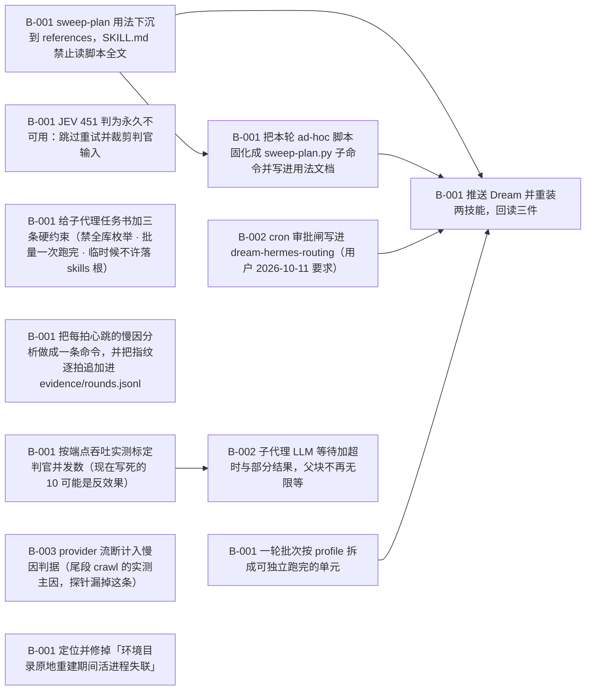

# Dream 执行效率优化（2026-10-11 实测基线驱动）

> 把单轮 dream 的成本从「47 分钟只走到 S2」压到可接受：削减每回合 prompt 与总回合数、把两条硬事实（判官 451 · cron 审批闸）固化进技能、按 profile 拆批以缩小失败重跑代价。

**进度** 1/12 块（8%） · 状态 `active` · 更新于 2026-10-11 13:44

**参与方** 本人(human)

## 现在该谁动（NOW / NEXT）

- `T-001#B-001` **sweep-plan 用法下沉到 references，SKILL.md 禁止读脚本全文** — 待认领 · @未指派
- `T-003#B-001` **JEV 451 判为永久不可用：跳过重试并裁剪判官输入** — 待认领 · @未指派
- `T-003#B-002` **cron 审批闸写进 dream-hermes-routing（用户 2026-10-11 要求）** — 待认领 · @未指派
- `T-004#B-001` **一轮批次按 profile 拆成可独立跑完的单元** — 待认领 · @未指派
- `T-006#B-001` **给子代理任务书加三条硬约束（禁全库枚举 · 批量一次跑完 · 临时候不许落 skills 根）** — 待认领 · @未指派
- `T-008#B-001` **按端点吞吐实测标定判官并发数（现在写死的 10 可能是反效果）** — 待认领 · @未指派
- `T-008#B-003` **provider 流断计入慢因判据（尾段 crawl 的实测主因，探针漏掉这条）** — 待认领 · @未指派
- `T-009#B-001` **定位并修掉「环境目录原地重建期间活进程失联」** — 待认领 · @未指派

## 图

## 任务

### T-001 上下文瘦身：sweep-plan 用法下沉，禁止主 run 读脚本全文 — 待认领
- [ ] `T-001#B-001` **sweep-plan 用法下沉到 references，SKILL.md 禁止读脚本全文** _impl_ — 待认领
    - 做什么：实测基线：主 run 把 scripts/sweep-plan.py 全文 read_file 进上下文（单条 56.4KB，会话内最大），此后 27 个回合每个都重放它 —— 每次 API 调用 prompt ≈56K tokens，LLM 中位回合 41.7s，占整轮 wall 的 93%。做法：新建 references/dream-sweep-cli.md（小于 2KB：scan / merge / dedupe 三条命令 + 参数 + 输出契约 + 失败退出码），SKILL.md 的 S1 / S4 / S9 三处转指改为指向它；检查点与反例各加一条：主 run 不许 read_file 脚本全文，只读 references/dream-sweep-cli.md。
    - 判据：① references/dream-sweep-cli.md 存在且字节数小于 2048（贴原文）；② SKILL.md 里点名该文件的转指 ≥ 3 处（贴 grep -n 原文）；③ python3 -B skills/dream/scripts/check-disclosure.py skills/dream --require-references exit 0（贴输出）；④ 反例段里有一条明写不许读脚本全文（原句贴出）。

### T-002 回合数压缩：ad-hoc 处理并进 sweep-plan.py 子命令 — 待排
- [ ] `T-002#B-001` **把本轮 ad-hoc 脚本固化成 sweep-plan.py 子命令并写进用法文档** _impl_ — 等前置
    - 做什么：实测：27 个回合里大半是 write_file 一个小脚本再 terminal 跑它（本轮 2033 / 257 / 893 / 2206 / 1798 / 613 / 2055 字节各一次），每写一次付一次完整 prompt，而工具本身中位只跑 0.2s。做法：把本轮真正写过的 ad-hoc 逻辑（profile 枚举 / 候选表汇总 / 判官分批 / 计划落盘）收进 scripts/sweep-plan.py 的既有子命令面，能并的并、不能并的写明理由；用法与输出契约写进 T-001 的 references/dream-sweep-cli.md。目标：主 run 单轮回合数从 27 降到 10 以内。
    - 判据：① python3 -B skills/dream/scripts/sweep-plan.py --help 的子命令面原文贴出；② 本轮 ad-hoc 脚本逐条对应到子命令，或写明不固化的理由（清单）；③ --self-test 通过（原文）；④ 下一轮 cron 运行的回合数实测值 ≤ 10（从 state.db 按 session_id 数 assistant 条数）。
    - 依赖：T-001#B-001

### T-003 两条硬事实：判官 451 永久降级 + cron 审批闸写进路由技能 — 待认领
- [ ] `T-003#B-001` **JEV 451 判为永久不可用：跳过重试并裁剪判官输入** _impl_ — 待认领
    - 做什么：实测：~/.hermes/.env 里 TYPESAFE_API_KEY 在（key_present=1），但探针稳定返回 http_status=451 Typesafe is not available in your region —— 这是地域性、永久性的，不是暂时故障，每轮都会白付一次探针与一个回合。做法：dream-hermes-routing 的判官接线一节改成「探针 451 ⇒ 判为永久不可用，直接走分类子代理，不再重试、不再每轮探活」；同时把判官输入裁到「标题 + 正文前 4KB + 正文总字节数」，避免 judge-input-bodies.json 整包进子代理。
    - 判据：① 路由技能里写明 451 为永久不可用的原句（贴出）；② 裁输入的具体规则与实现的 file:line（贴出）；③ 一次真跑的探针记录：探针只打一次且后续直接进子代理（贴命令与输出）。
- [ ] `T-003#B-002` **cron 审批闸写进 dream-hermes-routing（用户 2026-10-11 要求）** _impl_ — 待认领
    - 做什么：用户 2026-10-11 明确要求把这条审批限制写进 Dream 的文档。实测：cron 运行没有审批人，所以 terminal 里带 -e 或 -c 的 python3 调用被 BLOCKED、execute_code 被 BLOCKED —— 这不是失败可重试，是这条通路根本没有。做法：在 dream-hermes-routing 里新增一节，写明两条被挡的工具与替代做法（一切 ad-hoc 处理落成脚本文件，只用 python3 -B 加脚本路径，顺带避免 __pycache__ 让 hermes skills update 报 kept your local edits）。
    - 判据：① 路由技能里有一节写明 execute_code 与带 -e 或 -c 的 python3 在 cron 下被 BLOCKED（原句贴出）；② 替代做法写清 python3 -B 加脚本路径（原句贴出）；③ 该技能扫描 verdict = safe（原文）；④ 安装副本 diff -rq 为空。

### T-004 按 profile 拆批：缩小失败重跑代价 — 待认领
- [ ] `T-004#B-001` **一轮批次按 profile 拆成可独立跑完的单元** _impl_ — 待认领
    - 做什么：实测：本轮 09:07 起跑，47 分钟只走到 S2；今天 04:00 那一轮跑了 4h50m 后以 agent reported failure 结束 —— 整轮要么全成要么全废。做法：把批次按 profile 切成可独立跑完并落盘（每个 profile 一份中间产物 + 自己的报告尾），一轮内按 profile 顺序推进，单个 profile 失败不回滚已完成的；并发上限与分波规则写进 SKILL.md 的 S5 一节与 references/dream-agent-roster.md。
    - 判据：① 拆批后的命令面与中间产物路径（原文）；② 真跑一个 profile 并落盘的实测 wall time（命令 + 时间）；③ 中途 kill 后只重跑一个 profile 的代价实测（不超过单 profile wall time）；④ SKILL.md 的 S5 一节里有分波与并发上限的原句。

### T-005 推送·重装·回读（收尾） — 待排
前置 T-001, T-002, T-003, T-004
- [ ] `T-005#B-001` **推送 Dream 并重装两技能，回读三件** _impl_ — 等前置
    - 做什么：把 T-001 到 T-004 的改动按上游正路落地：只在项目里改，按 pathspec git add skills/ 与 plans/；commit 后 git push origin 该 sha 到 main（push 被拒先 fetch + rebase）；再 hermes skills update dream 与 dream-hermes-routing（整包重装），回读三件。
    - 判据：① push 的 sha 与 git log --oneline -1 origin/main 原文；② diff -rq 仓库 skills/dream 与 profile 安装副本为空（原文）；③ 逐文件 sha256 MATCH 清单；④ lock 里 dream 与 dream-hermes-routing 的 identifier 均指向 flmaximwang/Dream/skills/ 下的对应目录；⑤ 两份 SKILL.md 的字节数在 check-disclosure.py 上限内（贴输出）。
    - 依赖：T-001#B-001（任务级）
    - 依赖：T-002#B-001（任务级）
    - 依赖：T-003#B-001（任务级）
    - 依赖：T-003#B-002（任务级）
    - 依赖：T-004#B-001（任务级）

### T-006 子代理纪律：判官与审计的子代理不许自己撑爆上下文 — 待认领
- [ ] `T-006#B-001` **给子代理任务书加三条硬约束（禁全库枚举 · 批量一次跑完 · 临时候不许落 skills 根）** _impl_ — 待认领
    - 做什么：实测（2026-10-11 那一轮 S2 的 10 个子代理，143 次 API 调用）：平均每次调用 prompt 55.7K tokens、输出仅 399 tokens（140:1）；281 次工具往返里 read_file 130 次（中位 6.9KB、p90 24KB、最大 104.8KB）、terminal 98 次（结果中位仅 991B）。三个可归因的机制：① skills_list 被 9/10 个子代理调用，每次返回 63,145B 的全库列表 —— 判官根本不需要它，落点空间由题面 answer-space.json 给；② read_file 反复读大文件（57KB / 93KB / 102KB 各一发）与 skill_view 全文，把每个子代理的上下文撑到 100 至 230KB，之后每次调用都重放；③ 判定被拆成一条一个 terminal 往返（98 次、结果中位 991B），每次往返都要付一次完整大 prompt。做法：在 references/dream-agent-roster.md 的任务书通则里写死三条 —— 不许 skills_list 或枚举全库（落点空间只从题面取）；一个批次一次 write_file 落脚本加一次 terminal 跑完，禁止逐条往返；临时脚本只许落自己的 scratch 目录，不许落进任何 profile 的 skills 根。另：本轮实测有子代理把 _dream_enum.py 写进了 profiles/dev-general/skills/ 根目录（留存待清）。
    - 判据：① references/dream-agent-roster.md 里三条约束各有原句（贴出）；② 下一轮 cron 的子代理实测：单子代理 prompt 均值 < 25K tokens 且工具往返数 < 15（从 state.db 的 session_model_usage 与 messages 数出，贴数字）；③ profiles 各 skills 根目录里没有 3 小时内新增的散落 .py/_dream 前缀文件（贴扫描命令与空结果）；④ 本轮遗留的 profiles/dev-general/skills/_dream_enum.py 已清除（贴当时的 ls 与现在的 ls）。

### T-007 每拍心跳的慢因探针（同一把尺子） — 已完成
- [x] `T-007#B-001` **把每拍心跳的慢因分析做成一条命令，并把指纹逐拍追加进 evidence/rounds.jsonl** _impl_ — 已完成
    - 做什么：用户 2026-10-11 要求：以后每拍心跳都要分析 dream 为什么慢，并更新本 plan。循环指令自己的纪律是「每拍用同一条命令取指纹，换了取法数字就不可比」「只报与上一拍相比变了的部分」—— 所以这件事必须做成一条命令，而不是每拍手搓五条 sqlite 查询。做法：plans/dream-perf/tools/perf-probe.py（纯 stdlib、只读 ~/.hermes/state.db）一次给出：主 run 的 wall/静默/上下文峰值、LLM 回合中位与最长、工具占比、每次调用的 prompt 与 output、上下文炸弹（单条工具结果大于 40KB）、10 路子代理的调用数与工具往返与跨度、各 profile skills 根 3 小时内的散落文件；按固定规则算出本拍的前二慢因（上下文重放 / 子代理同类问题 / 超长回合 / 静默 / 炸弹 / 越界残留），把这一拍追加进 evidence/rounds.jsonl 并打印与上一拍的差。每拍的动作固定为：跑探针 → 差异只报增量 → 探针给出新慢因就跑 loomerto 加块或改块，没有新慢因就跑 loomerto note 记一行。
    - 判据：① python3 -B plans/dream-perf/tools/perf-probe.py --self-test 输出 self-test ok（贴原文）；② 真跑一次并把输出贴进 note（含 Δ 上一拍一行）；③ evidence/rounds.jsonl 存在且每拍追加一行合法 JSON（贴 wc -l 与最后一行的键名）；④ 探针报出的慢因与人工核算一致：主 run 每次调用 prompt 56.5K、子代理每调用 61.2K、最长回合 576s（贴人工核算的 sqlite 原文）。
    - 产物：`/Users/maxim/Repositories/Repo/Dream/plans/dream-perf/tools/perf-probe.py`
    - 产物：`/Users/maxim/Repositories/Repo/Dream/plans/dream-perf/evidence/rounds.jsonl`
    - run 2026-10-11 10:20 hermes pending→done self-test ok；真跑第一拍指纹：主 run 72.9min / 静默 25.9min / 每次调用 prompt 56.5K / 最长回合 576s；子代理 10 个 158 次调用每调用 61.2K；散落文件 1 个（dev-general/skills/_dream_enum.py）

### T-008 扇出等待模型：并发数按端点吞吐标定 + 子代理等待要有超时 — 待认领
- [ ] `T-008#B-001` **按端点吞吐实测标定判官并发数（现在写死的 10 可能是反效果）** _impl_ — 待认领
    - 做什么：待验证假设（原 doc 把它当事实写了，2026-10-11 10:55 已按新证据改回假设）。观察到的现象：同一批 10 个子代理里，一段时间内只有 2 至 9 个在动，其余在工具结果后十几分钟无新消息；整批吞吐从 10:05 的 31 次/5min 单调衰减到 10:50 的 1 次/5min。**但 10:25 之后的衰减已另有更强解释**（见 T-009：10:51:33 运行期环境目录被回收，任何新建 httpx 客户端都在 truststore 载入处 FileNotFoundError）。所以「端点按并发排队」目前只是候选之一，未被证明。做法（不变，仍要做）：用同一批判官输入跑三组对照（并发 1 / 4 / 10），各测「单次调用等待中位数」与「整批 wall」与「总 prompt tokens」，并且必须先把环境回收这条排除干净，否则测出来的是地基塌陷不是排队。结论落进 dream-agent-roster.md，写明这个数是按当前端点标定的、换端点要重标。
    - 判据：① 三组对照的实测表（并发数 / 单次调用等待中位 / 整批 wall / 总 prompt tokens）原文贴出；② 拐点结论一句话 + 选定的并发数；③ dream-agent-roster.md 里并发数字已按实测更新（贴前后 diff）；④ 下一轮 cron 的 max(单个子代理 idle) 小于 5 分钟（贴探针输出）。
- [ ] `T-008#B-002` **子代理 LLM 等待加超时与部分结果，父块不再无限等** _impl_ — 等前置
    - 做什么：实测证据：本轮 09:54:39 派发 10 个子代理，父块到 10:31 已静默 36.8 分钟且仍在等；期间没有任何超时、看门狗或早退。父块的 delegate_task 语义是「等全部孩子」，所以任何一个卡住的孩子就能把整轮钉死到天亮 —— 这与 T-004（按 profile 拆批）治的病不同：拆批减小粒度，这里治的是「等待没有上限」。做法：① 子代理任务书里加一条硬约束：单次 LLM 等待超过 N 分钟就写一份部分结果（已完成条目的 verdicts 落盘）后退出，不许原地等；② 父块要有降级路径：M 分钟未归就带着已归的部分继续走，未归的行按「没判完」单列进汇报（dream 的无人值守口径本来就有这一档），不许把整轮挂在等待上。
    - 判据：① dream-agent-roster.md 里超时与部分结果那条的原句（贴出）；② 父块降级路径的原句（未归的行怎么标、怎么进汇报）；③ 一次真实演练：人为让一个子代理超时，父块在 M 分钟内带部分结果继续（贴时间线与输出）；④ 下一轮 cron 不再出现「父块静默超过 15 分钟且全部子代理 idle」的状态（贴探针输出）。
    - 依赖：T-008#B-001
- [ ] `T-008#B-003` **provider 流断计入慢因判据（尾段 crawl 的实测主因，探针漏掉这条）** _impl_ — 待认领
    - 做什么：尾段 crawl 的实测主因：monk 的流断（不是端点按并发排队）。2026-10-11 12:33–12:44 实读 state.db + ~/.hermes/logs/gateway.error.log。

现象：3 个未交卷孩子全部停在「等 stream」，不是卡在工具或逻辑。
- 33698e：最近产出 11:56:34，其后一直在同一回合等流（12:43 原文 `waiting for stream response (219s, post_chunk)`）⇒ 约 47min 无新消息。
- 2529f2：最近产出 12:10:02，12:43 等流 126s。
- d25f75：唯一还在推进的（12:38:55 产出），api 调用 22→25 花了 10min。

日志证据（同一批孩子/父块，base_url=https://monk.party/v1，上游 Cloudflare LAX）：
- `Stream stale for 180–300s (threshold) — no chunks received. Killing connection. model=monk`
- `Stream drop on attempt 1/3 … error_type=ReadTimeout … elapsed=2508.01s ttfb=7.40s chunks=2114 finish_reason_seen=False`
- `RemoteProtocolError: peer closed connection without sending complete message body (incomplete chunked read)`（depth=0 与 depth=1 都出现）
- TLS 对 monk 的握手直接超时：12:09:27、12:13:49 `httpcore.ConnectTimeout: handshake operation timed out`

小时计数（今天，同一份 error log）：10 点档 api_failed 80 / stream drop 25 / stale 22；11 点 27/14/8；12 点至 12:44 共 3 次（12:34 depth=0、12:38 depth=1）。10:25 起吞吐单调衰减的「第三种解释」就在这里，与 T-009（环境目录被回收）和 T-008#B-001（端点排队）并列。

判据缺口：探针这一拍报 `api_failed` 为 0，但孩子正在以 8min/次调用爬 —— 探针只数 API 失败，不数流断重试，所以「provider 流断」这条慢因对探针不可见。

处置候选（不要在这一块里动手，只记录）：a) 该 job 的 model 现在 pinned 到 monk（`hermes cron edit 52fe6cf3a3dc --model <x> --provider <y>`）；b) 给子代理的流等待加超时上限（T-008 原意）。
    - 判据：① perf-probe.py 新增一行「近 N 分钟 stream stale / stream drop / 握手超时计数（父/子分列）」并跑 --self-test 通过；② 下一拍探针输出里该行给出实测数值，且能据此区分「端点排队」与「provider 流断」两解释；③ 贴出改动前后探针输出原文

### T-009 运行期地基被拆：环境目录被回收 — 待认领
- [ ] `T-009#B-001` **定位并修掉「环境目录原地重建期间活进程失联」** _impl_ — 待认领
    - 做什么：实测证据链（2026-10-11，11:05 定版 —— 结论已修正一次，别再退回旧说法）：**不是「被 GC 回收」，是「原地删掉又重建」同一个环境**。① 09:50 我还成功用过 environments/51e7b11d1f0e44bcba68d977a823d512/venv/bin/python3；② 该目录在 10:51:33 被删（environments/ mtime = 10:51:33，路径一度不存在）；③ 10:51:13 起 gateway.error.log 出现 FileNotFoundError：httpx create_ssl_context → truststore load_verify_locations，provider=custom base_url=https://monk.party/v1 model=monk，到 11:02 的 15 分钟窗口内 API failed 69 · provider down 14 · FileNotFoundError 122；④ 该错只在**新建** httpx/openai 客户端时触发（内存里已导入模块的调用照旧能跑）⇒ 表现为部分子代理动、其余卡死（8/10 idle 超 10 分钟，最长 33.9 分钟）；⑤ **11:02:03 同一个 hash 的环境目录重新出现且可用**（venv/bin/python3 能 import httpx / truststore / discord），11:02:05 之后再无 FileNotFoundError（尾部只剩 3 条 APITimeoutError），子代理 11:03:27 恢复动作 ⇒ **因果确证：卡死就是这段「路径不存在」的窗口造成的，不是网络**；⑥ 网络与证书始终正常：curl 直连与走代理都是 401、monk 端点 1.25s 可达，iron-proxy egress 未启用，config 里没有证书变量；⑦ **背景压力**：App Store 在装 Xcode（/Applications/Xcode.app mtime 10:59:02、install.log 里 appstoreagent 10:59:35 注册 bundle、load average 16.7/18.0/15.7、空闲内存一度只剩 136MB、mds_stores 占 43 至 119% CPU），与吞吐从 10:25 起单调衰减（31→29→13→11→9→4→1 次/5min）时间吻合；⑧ 附带伤害：/usr/bin/python3 与 /usr/bin/git 一度双双不可用（Xcode 许可未同意，退出码 69），11:03 用户执行许可同意后恢复（Python 3.9.6 / git 2.54.0）。做法（修正后）：重建必须在**新 hash 的目录里建好再原子切换**，不许把活进程正在用的目录先删后建；重建前检测引用（有活进程在用就推迟或换 hash），并把「重建窗口」写进日志与探针告警。
    - 判据：① 定案证据：给出回收触发者与阈值（能复现，或能指到 file:line 与触发条件）；② 修法落地且可验证：跑一个长任务跨越一次回收时机，全程无 FileNotFoundError（贴改前改后错误计数对比）；③ 回归闸：一条自检说明「被活进程引用的环境不回收」（贴命令与输出）；④ 下一轮 cron 的 error log 里不再出现 retry 风暴（贴 grep -c 原文）；⑤ 附带项已处理：/usr/bin/python3 可用（贴 python3 -V 输出）或已明确绕开方案并记录在案。

## 日志（近 20 条）

- `2026-10-11 10:20` **agent** [decision] 用户 2026-10-11 起的固定动作：每拍心跳跑 tools/perf-probe.py 取同一把尺子的指纹，只报增量；探针报出新慢因就加块/改块，没有就 note 记一行。
- `2026-10-11 10:20` **agent** [block] T-007#B-001 改了 做什么
- `2026-10-11 10:31` **agent** [task] 新增任务 T-008「扇出等待模型：并发数按端点吞吐标定 + 子代理等待要有超时」
- `2026-10-11 10:31` **agent** [block] 新增块 T-008#B-001「按端点吞吐实测标定判官并发数（现在写死的 10 可能是反效果）」
- `2026-10-11 10:31` **agent** [block] 新增块 T-008#B-002「子代理 LLM 等待加超时与部分结果，父块不再无限等」
- `2026-10-11 10:54` **agent** [block] T-008#B-001 改了 做什么
- `2026-10-11 10:54` **agent** [task] 新增任务 T-009「运行期地基被拆：环境目录被回收」
- `2026-10-11 10:54` **agent** [block] 新增块 T-009#B-001「定位并修掉「运行中的 Hermes 环境目录被回收」」
- `2026-10-11 10:54` **agent** [decision] 定案纠正：10:25 之后的吞吐衰减不是端点排队。10:51:33 运行中的环境目录 installs/b200403c2b90970e/environments/51e7b11d... 被回收，此后任何新建 httpx 客户端都在 truststore 载入处 FileNotFoundError（monk 调用全部失败），表现为部分子代理卡死。T-008#B-001 的原文已从「事实」降回「待验证假设」，新开 T-009 追这一条。
- `2026-10-11 11:02` **agent** [block] T-009#B-001 改了 做什么
- `2026-10-11 11:02` **agent** [status] T-009#B-001: pending → pending（done_when 已更新）
- `2026-10-11 11:04` **agent** [block] T-009#B-001 改了 标题
- `2026-10-11 11:04` **agent** [block] T-009#B-001 改了 做什么
- `2026-10-11 11:53` **agent** [decision] 11:37 拍：上一拍的两条 !! 全部消失——15min 内 api_failed 69→2、provider_down 14→0、FileNotFoundError 122→0，env_touched 由 /Users/maxim/.hermes/installs/b200403c2b90970e/environments 变为 null。即 T-009 记录的环境目录原地重建风暴已平息（回收完成）。同时父 run 静默 69.2→103.2min 且 LLM 回合数/调用数自 11:02 起冻在 27/28 未动，而子代理 kids_calls 仍 207→212、跨度 68.8→87.7min ⇒ 父进程纯粹卡在扇出等待（T-008 已成的块），不是新的慢因。无新慢因，不动计划。
- `2026-10-11 12:35` **agent** [decision] 12:35 复核扇出尾段：最后活着的是 d25f75（12:32:45 仍在调工具），2529f2/33698e 分别静默 25/38min。慢因不是子代理死了，是 monk 端流卡死：gateway.error.log 12:34 见 'Stream stale for 180s — no chunks received — Killing connection' + ReadTimeout + 'attempt 1/3' 重试（provider=custom base_url=https://monk.party/v1）。探针的 15min 错误计数只认 'API call failed'/'Provider unavailable' 字面，漏掉这种「流卡死→重试」，所以连续几拍都报「无新慢因」。判据：父静默 + 全部孩子 15min 无调用 = 真死锁才重启 gateway（唯一中止手段）。
- `2026-10-11 12:44` **agent** [block] 新增块 T-008#B-003「provider 流断计入慢因判据（尾段 crawl 的实测主因，探针漏掉这条）」
- `2026-10-11 12:44` **agent** [decision] 12:33-12:44 实读：父块 09:54:33 起挂在 delegate_task（扇出栅栏），3 个未交卷孩子全在等 monk 的 stream；日志实测 Stream stale 180-300s no chunks、elapsed=2508s 的 ReadTimeout、RemoteProtocolError、TLS 握手超时两次。探针当拍报 api_failed=0 ⇒ 流断这条慢因对探针不可见，已落成 T-008#B-003。
- `2026-10-11 13:01` **agent** [decision] 更正 12:35 那条里写的止损线：15min 是假信号。实测本 run 孩子静默 38min 后恢复过两次（33698e 11:18→11:56、2529f2 11:22→12:01），monk 流卡死 180s/次、单回合重试 3 次。13:01 复核：唯一还在动的 d25f75 也已静默 22min（msgs 67→76、calls 22→25 是它 12:32–12:38 的进展），但按实测这不算死锁。新判据（已写进 HANDOFF §3）：全部孩子连续 ≥45min 无任何调用 且 父静默 ≥4h，或越过 4h50m（04:00 那轮失败点）仍无孩子交卷，才重启 gateway。
- `2026-10-11 13:39` **agent** [decision] 04:00 那轮的死因定案（T-008#B-003 的补充证据）：父块 08:50:24 收到的 delegate_task 结果是 status=interrupted、summary="Operation interrupted: waiting for model response (15910.8s elapsed)" —— 15910.8s = 4h25m 等一次模型响应，就是 monk 的流断拖到被中断上限收掉，整轮才记 failed。即：不是 dream 逻辑失败，是 provider 把子代理的等待拖过了上限。
- `2026-10-11 13:44` **agent** [decision] 13:45 本机实测 A/B（同一台机器、同一时刻，各 2 次、max_tokens=24 的流式小请求）：monk ttfb 34.8s / 10.2s；deepseek ttfb 0.79s / 0.88s（总 1.0-1.3s）。裸连 https://monk.party/v1/models 三次：一次 20s 收 0 字节，另两次 TLS 握手 0.57s / 13.3s。今天 error log 计数：handshake 超时 104、peer closed connection 66、ReadTimeout 46、APITimeoutError 52、APIConnectionError 28、Stream stale 180/240/300s 共 46。⇒ monk 侧（或它前面的 Cloudflare LAX 边缘）确实不稳定，不是本机网络、不是 dream 逻辑；大 context（子代理每次 prompt ~75K）时最差。

---
plan.json 是唯一真相；本文件与 plan.html / plan.canvas 由 `plan.py render dream-perf` 生成。
