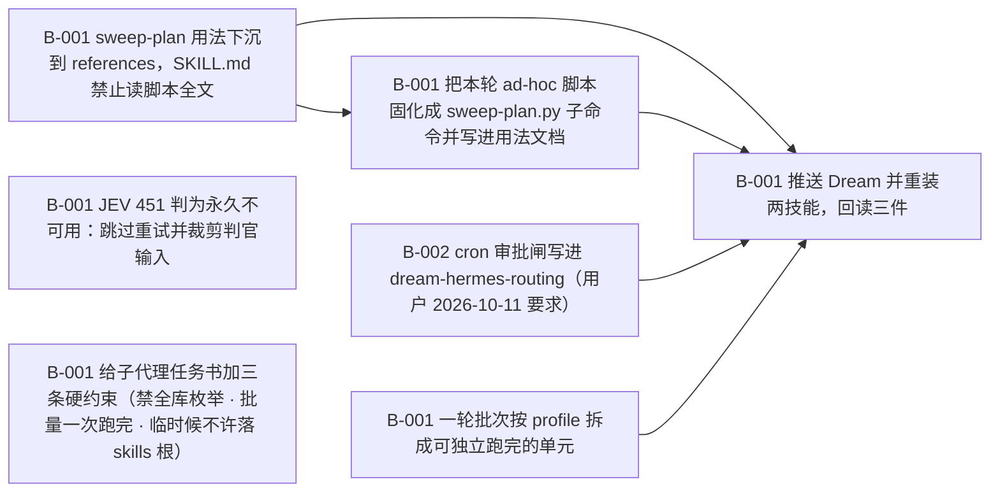

# Dream 执行效率优化（2026-10-11 实测基线驱动）

> 把单轮 dream 的成本从「47 分钟只走到 S2」压到可接受：削减每回合 prompt 与总回合数、把两条硬事实（判官 451 · cron 审批闸）固化进技能、按 profile 拆批以缩小失败重跑代价。

**进度** 0/7 块（0%） · 状态 `active` · 更新于 2026-10-11 10:16

**参与方** 本人(human)

## 现在该谁动（NOW / NEXT）

- `T-001#B-001` **sweep-plan 用法下沉到 references，SKILL.md 禁止读脚本全文** — 待认领 · @未指派
- `T-003#B-001` **JEV 451 判为永久不可用：跳过重试并裁剪判官输入** — 待认领 · @未指派
- `T-003#B-002` **cron 审批闸写进 dream-hermes-routing（用户 2026-10-11 要求）** — 待认领 · @未指派
- `T-004#B-001` **一轮批次按 profile 拆成可独立跑完的单元** — 待认领 · @未指派
- `T-006#B-001` **给子代理任务书加三条硬约束（禁全库枚举 · 批量一次跑完 · 临时候不许落 skills 根）** — 待认领 · @未指派

## 图

## 任务

### T-001 上下文瘦身：sweep-plan 用法下沉，禁止主 run 读脚本全文 — 待认领
- [ ] `T-001#B-001` **sweep-plan 用法下沉到 references，SKILL.md 禁止读脚本全文** _impl_ — 待认领
    - 做什么：实测基线：主 run 把 scripts/sweep-plan.py 全文 read_file 进上下文（单条 56.4KB，会话内最大），此后 27 个回合每个都重放它 —— 每次 API 调用 prompt ≈56K tokens，LLM 中位回合 41.7s，占整轮 wall 的 93%。做法：新建 references/dream-sweep-cli.md（小于 2KB：scan / merge / dedupe 三条命令 + 参数 + 输出契约 + 失败退出码），SKILL.md 的 S1 / S4 / S9 三处转指改为指向它；检查点与反例各加一条：主 run 不许 read_file 脚本全文，只读 references/dream-sweep-cli.md。
    - 判据：① references/dream-sweep-cli.md 存在且字节数小于 2048（贴原文）；② SKILL.md 里点名该文件的转指 ≥ 3 处（贴 grep -n 原文）；③ python3 -B skills/dream/scripts/check-disclosure.py skills/dream --require-references exit 0（贴输出）；④ 反例段里有一条明写不许读脚本全文（原句贴出）。

### T-002 回合数压缩：ad-hoc 处理并进 sweep-plan.py 子命令 — 待排
- [ ] `T-002#B-001` **把本轮 ad-hoc 脚本固化成 sweep-plan.py 子命令并写进用法文档** _impl_ — 等前置
    - 做什么：实测：27 个回合里大半是 write_file 一个小脚本再 terminal 跑它（本轮 2033 / 257 / 893 / 2206 / 1798 / 613 / 2055 字节各一次），每写一次付一次完整 prompt，而工具本身中位只跑 0.2s。做法：把本轮真正写过的 ad-hoc 逻辑（profile 枚举 / 候选表汇总 / 判官分批 / 计划落盘）收进 scripts/sweep-plan.py 的既有子命令面，能并的并、不能并的写明理由；用法与输出契约写进 T-001 的 references/dream-sweep-cli.md。目标：主 run 单轮回合数从 27 降到 10 以内。
    - 判据：① python3 -B skills/dream/scripts/sweep-plan.py --help 的子命令面原文贴出；② 本轮 ad-hoc 脚本逐条对应到子命令，或写明不固化的理由（清单）；③ --self-test 通过（原文）；④ 下一轮 cron 运行的回合数实测值 ≤ 10（从 state.db 按 session_id 数 assistant 条数）。
    - 依赖：T-001#B-001

### T-003 两条硬事实：判官 451 永久降级 + cron 审批闸写进路由技能 — 待认领
- [ ] `T-003#B-001` **JEV 451 判为永久不可用：跳过重试并裁剪判官输入** _impl_ — 待认领
    - 做什么：实测：~/.hermes/.env 里 TYPESAFE_API_KEY 在（key_present=1），但探针稳定返回 http_status=451 Typesafe is not available in your region —— 这是地域性、永久性的，不是暂时故障，每轮都会白付一次探针与一个回合。做法：dream-hermes-routing 的判官接线一节改成「探针 451 ⇒ 判为永久不可用，直接走分类子代理，不再重试、不再每轮探活」；同时把判官输入裁到「标题 + 正文前 4KB + 正文总字节数」，避免 judge-input-bodies.json 整包进子代理。
    - 判据：① 路由技能里写明 451 为永久不可用的原句（贴出）；② 裁输入的具体规则与实现的 file:line（贴出）；③ 一次真跑的探针记录：探针只打一次且后续直接进子代理（贴命令与输出）。
- [ ] `T-003#B-002` **cron 审批闸写进 dream-hermes-routing（用户 2026-10-11 要求）** _impl_ — 待认领
    - 做什么：用户 2026-10-11 明确要求把这条审批限制写进 Dream 的文档。实测：cron 运行没有审批人，所以 terminal 里带 -e 或 -c 的 python3 调用被 BLOCKED、execute_code 被 BLOCKED —— 这不是失败可重试，是这条通路根本没有。做法：在 dream-hermes-routing 里新增一节，写明两条被挡的工具与替代做法（一切 ad-hoc 处理落成脚本文件，只用 python3 -B 加脚本路径，顺带避免 __pycache__ 让 hermes skills update 报 kept your local edits）。
    - 判据：① 路由技能里有一节写明 execute_code 与带 -e 或 -c 的 python3 在 cron 下被 BLOCKED（原句贴出）；② 替代做法写清 python3 -B 加脚本路径（原句贴出）；③ 该技能扫描 verdict = safe（原文）；④ 安装副本 diff -rq 为空。

### T-004 按 profile 拆批：缩小失败重跑代价 — 待认领
- [ ] `T-004#B-001` **一轮批次按 profile 拆成可独立跑完的单元** _impl_ — 待认领
    - 做什么：实测：本轮 09:07 起跑，47 分钟只走到 S2；今天 04:00 那一轮跑了 4h50m 后以 agent reported failure 结束 —— 整轮要么全成要么全废。做法：把批次按 profile 切成可独立跑完并落盘（每个 profile 一份中间产物 + 自己的报告尾），一轮内按 profile 顺序推进，单个 profile 失败不回滚已完成的；并发上限与分波规则写进 SKILL.md 的 S5 一节与 references/dream-agent-roster.md。
    - 判据：① 拆批后的命令面与中间产物路径（原文）；② 真跑一个 profile 并落盘的实测 wall time（命令 + 时间）；③ 中途 kill 后只重跑一个 profile 的代价实测（不超过单 profile wall time）；④ SKILL.md 的 S5 一节里有分波与并发上限的原句。

### T-005 推送·重装·回读（收尾） — 待排
前置 T-001, T-002, T-003, T-004
- [ ] `T-005#B-001` **推送 Dream 并重装两技能，回读三件** _impl_ — 等前置
    - 做什么：把 T-001 到 T-004 的改动按上游正路落地：只在项目里改，按 pathspec git add skills/ 与 plans/；commit 后 git push origin 该 sha 到 main（push 被拒先 fetch + rebase）；再 hermes skills update dream 与 dream-hermes-routing（整包重装），回读三件。
    - 判据：① push 的 sha 与 git log --oneline -1 origin/main 原文；② diff -rq 仓库 skills/dream 与 profile 安装副本为空（原文）；③ 逐文件 sha256 MATCH 清单；④ lock 里 dream 与 dream-hermes-routing 的 identifier 均指向 flmaximwang/Dream/skills/ 下的对应目录；⑤ 两份 SKILL.md 的字节数在 check-disclosure.py 上限内（贴输出）。
    - 依赖：T-001#B-001（任务级）
    - 依赖：T-002#B-001（任务级）
    - 依赖：T-003#B-001（任务级）
    - 依赖：T-003#B-002（任务级）
    - 依赖：T-004#B-001（任务级）

### T-006 子代理纪律：判官与审计的子代理不许自己撑爆上下文 — 待认领
- [ ] `T-006#B-001` **给子代理任务书加三条硬约束（禁全库枚举 · 批量一次跑完 · 临时候不许落 skills 根）** _impl_ — 待认领
    - 做什么：实测（2026-10-11 那一轮 S2 的 10 个子代理，143 次 API 调用）：平均每次调用 prompt 55.7K tokens、输出仅 399 tokens（140:1）；281 次工具往返里 read_file 130 次（中位 6.9KB、p90 24KB、最大 104.8KB）、terminal 98 次（结果中位仅 991B）。三个可归因的机制：① skills_list 被 9/10 个子代理调用，每次返回 63,145B 的全库列表 —— 判官根本不需要它，落点空间由题面 answer-space.json 给；② read_file 反复读大文件（57KB / 93KB / 102KB 各一发）与 skill_view 全文，把每个子代理的上下文撑到 100 至 230KB，之后每次调用都重放；③ 判定被拆成一条一个 terminal 往返（98 次、结果中位 991B），每次往返都要付一次完整大 prompt。做法：在 references/dream-agent-roster.md 的任务书通则里写死三条 —— 不许 skills_list 或枚举全库（落点空间只从题面取）；一个批次一次 write_file 落脚本加一次 terminal 跑完，禁止逐条往返；临时脚本只许落自己的 scratch 目录，不许落进任何 profile 的 skills 根。另：本轮实测有子代理把 _dream_enum.py 写进了 profiles/dev-general/skills/ 根目录（留存待清）。
    - 判据：① references/dream-agent-roster.md 里三条约束各有原句（贴出）；② 下一轮 cron 的子代理实测：单子代理 prompt 均值 < 25K tokens 且工具往返数 < 15（从 state.db 的 session_model_usage 与 messages 数出，贴数字）；③ profiles 各 skills 根目录里没有 3 小时内新增的散落 .py/_dream 前缀文件（贴扫描命令与空结果）；④ 本轮遗留的 profiles/dev-general/skills/_dream_enum.py 已清除（贴当时的 ls 与现在的 ls）。

## 日志（近 20 条）

- `2026-10-11 10:08` **agent** [created] 建立 plan：Dream 执行效率优化（2026-10-11 实测基线驱动）
- `2026-10-11 10:08` **agent** [task] 新增任务 T-001「上下文瘦身：sweep-plan 用法下沉，禁止主 run 读脚本全文」
- `2026-10-11 10:08` **agent** [task] 新增任务 T-002「回合数压缩：ad-hoc 处理并进 sweep-plan.py 子命令」
- `2026-10-11 10:08` **agent** [task] 新增任务 T-003「两条硬事实：判官 451 永久降级 + cron 审批闸写进路由技能」
- `2026-10-11 10:08` **agent** [task] 新增任务 T-004「按 profile 拆批：缩小失败重跑代价」
- `2026-10-11 10:08` **agent** [task] 新增任务 T-005「推送·重装·回读（收尾）」
- `2026-10-11 10:08` **agent** [block] 新增块 T-001#B-001「sweep-plan 用法下沉到 references，SKILL.md 禁止读脚本全文」
- `2026-10-11 10:08` **agent** [block] 新增块 T-002#B-001「把本轮 ad-hoc 脚本固化成 sweep-plan.py 子命令并写进用法文档」
- `2026-10-11 10:08` **agent** [block] 新增块 T-003#B-001「JEV 451 判为永久不可用：跳过重试并裁剪判官输入」
- `2026-10-11 10:08` **agent** [block] 新增块 T-003#B-002「cron 审批闸写进 dream-hermes-routing（用户 2026-10-11 要求）」
- `2026-10-11 10:08` **agent** [block] 新增块 T-004#B-001「一轮批次按 profile 拆成可独立跑完的单元」
- `2026-10-11 10:08` **agent** [block] 新增块 T-005#B-001「推送 Dream 并重装两技能，回读三件」
- `2026-10-11 10:16` **agent** [task] 新增任务 T-006「子代理纪律：判官与审计的子代理不许自己撑爆上下文」
- `2026-10-11 10:16` **agent** [block] 新增块 T-006#B-001「给子代理任务书加三条硬约束（禁全库枚举 · 批量一次跑完 · 临时候不许落 skills 根）」

---
plan.json 是唯一真相；本文件与 plan.html / plan.canvas 由 `plan.py render dream-perf` 生成。
