# dream 升级：从 UsingHermes 的 skill 变成 Repo 里的独立项目

> 把 dream 升级成 ~/Repositories/Repo/Dream 独立项目（general 方法 = 主技能）+ AgentSkill-UsingHermes 里的 dream-hermes-routing 路由技能；把用户 2026-10-11 提的 8 条新要求落进方法；03:00 起跑、04:00 前完成，验收必须包含 dream 已正确安装。计划持久化在本项目里（plans/dream-upgrade/）。

**进度** 0/14 块（0%） · 状态 `active` · 更新于 2026-10-11 01:14

**参与方** Stronghold3369(human) · 本人(human)

## 现在该谁动（NOW / NEXT）

- `T-001#B-001` **勘察台账：三处 dream 现状逐文件 sha256 + 在途改进盘点** — 已认领 · @dream-upgrade-runner

## 图

```mermaid
flowchart LR
  T-001_B-001["B-001 勘察台账：三处 dream 现状逐文件 sha256 + 在途改进盘点"]
  T-002_B-001["B-001 Dream 项目骨架 + gh repo create + 首推（计划随项目提交）"]
  T-003_B-001["B-001 抽取 general dream skill 进 Dream 项目，剥掉 hermes 专有内容"]
  T-003_B-002["B-002 分层披露改造：文档聚类 → 文档树 → 单文档长度上限"]
  T-004_B-001["B-001 多根外部技能源（含 ~/Repositories/Repo）+ 两张清单 + .env 登记"]
  T-004_B-002["B-002 跨 repo 去重（仅保留在最相关的 repo）+ 两个上限常量"]
  T-005_B-001["B-001 在 AgentSkill-UsingHermes 写 dream-hermes-routing，并删掉该包的 skills/dream"]
  T-006_B-001["B-001 推送两处仓库（Dream + UsingHermes），先 fetch/rebase"]
  T-006_B-002["B-002 装回 profile 并回读三件"]
  T-007_B-001["B-001 把 4 点那次 dream 的 cron prompt 换成新方法"]
  T-008_B-001["B-001 独立只读验证（与所有 writer 不同的子代理）"]
  T-008_B-002["B-002 验收清单 docs/acceptance.md 落进项目并提交"]
  T-009_B-001["B-001 收尾：清 worktree/临时产物 + 跑 check-commands 与 check-temps"]
  T-009_B-002["B-002 汇报到 Discord thread（结论 + 该谁动 + plan.html URL + 块进度）"]
  T-001_B-001 --> T-002_B-001
  T-002_B-001 --> T-003_B-001
  T-003_B-001 --> T-003_B-002
  T-003_B-002 --> T-004_B-001
  T-004_B-001 --> T-004_B-002
  T-003_B-001 --> T-005_B-001
  T-002_B-001 --> T-006_B-001
  T-003_B-002 --> T-006_B-001
  T-004_B-002 --> T-006_B-001
  T-005_B-001 --> T-006_B-001
  T-006_B-001 --> T-006_B-002
  T-006_B-002 --> T-007_B-001
  T-007_B-001 --> T-008_B-001
  T-003_B-002 --> T-008_B-001
  T-008_B-001 --> T-008_B-002
  T-008_B-002 --> T-009_B-001
  T-009_B-001 --> T-009_B-002
  classDef claimed stroke-width:1px;
  class T-001_B-001 claimed;
  classDef waiting stroke-width:1px;
  class T-002_B-001,T-003_B-001,T-003_B-002,T-004_B-001,T-004_B-002,T-005_B-001,T-006_B-001,T-006_B-002,T-007_B-001,T-008_B-001,T-008_B-002,T-009_B-001,T-009_B-002 waiting;
```

## 任务

### T-001 勘察与现场冻结 — 进行中
- [ ] `T-001#B-001` **勘察台账：三处 dream 现状逐文件 sha256 + 在途改进盘点** _impl_ — 已认领 @dream-upgrade-runner
    - 做什么：在 worktree 上作业前先读清现场。① git -C /Users/maxim/Documents/AgentSkill/AgentSkill-UsingHermes fetch，然后读 git log --oneline -3 origin/main、git status --short、git worktree list、git branch -a --sort=-committerdate。01:00 那个 cron 正在 dream-nostay 分支/worktree 上改同一个包，02:00 还有一单要动 AgentSkill-AgentEvolution：这些在途改动是要合并的东西，不是噪音，不许覆盖。② 对 dream 现状三处建逐文件 sha256 台账，落 /Users/maxim/Repositories/Repo/Dream/plans/dream-upgrade/evidence/sha256-before.tsv：clone 的 skills/dream、profile 安装副本 ~/.hermes/skills/hermes/dream、~/.hermes/skills/.hub/lock.json 里 installed.dream 的 files 与 source_revision。③ 读 ~/.hermes/.env 里外部技能目录的登记行，用 grep -c 计数、不回显值。本机 shell 输出经包装层（rtk）过滤，逐文件清单/计数一律用 Python（os.walk）做。
    - 判据：sha256-before.tsv 存在且三处逐文件对照（列：相对路径 + clone + profile + lock 的 sha256）；origin/main HEAD 与 worktree/branch 列表原文贴出；.env 登记行的键名与 grep -c 计数贴出。

### T-002 Dream 项目骨架 + 首推 — 待排
- [ ] `T-002#B-001` **Dream 项目骨架 + gh repo create + 首推（计划随项目提交）** _impl_ — 等前置 @dream-upgrade-runner
    - 做什么：① 在 /Users/maxim/Repositories/Repo/Dream（已 git init，plans/dream-upgrade 已是本计划）写 README.md：索引表（skills/dream = general 方法主技能；plans/ = 本项目的 loomerto 计划；docs/acceptance.md = 验收清单）+ 三段式安装命令 hermes skills install flmaximwang/Dream/skills/dream + 当前状态（装/不装）一段，照同族项目写。② gh repo create flmaximwang/Dream --private --description "dream: 把 profile 里无仓库归属的本地技能批量收编进技能包仓库（general 方法）"（幂等：已存在就 gh repo view 确认后复用）。③ 建完立刻 git remote set-url origin git@github.com:flmaximwang/Dream.git（gh 建出来是 https，裸 push 会卡在凭据提示直到超时）。④ 只按 pathspec add（README.md、plans/、skills/、docs/），commit，git push -u origin main。plans/ 必须在提交里——这就是「计划持久化存储到项目中」的判据。
    - 判据：gh repo view flmaximwang/Dream --json name,visibility 显示存在且 PRIVATE；git -C /Users/maxim/Repositories/Repo/Dream log --oneline -1 origin/main 等于本次 sha；git show --stat 该 sha 里含 plans/dream-upgrade/plan.json 与 plan.html；README 里那行安装命令原文贴出。
    - 依赖：T-001#B-001

### T-003 抽取 general dream skill 进项目（含分层披露改造） — 待排
- [ ] `T-003#B-001` **抽取 general dream skill 进 Dream 项目，剥掉 hermes 专有内容** _impl_ — 等前置 @dream-upgrade-runner
    - 做什么：把 skills/dream（以 AgentSkill-UsingHermes 的 origin/main 最新版为准，不是 profile 里那份）搬进 Dream/skills/dream，并按 general 口径改写：Hermes 专有机制（profile 与 .env 路径、.hub/lock.json 与 .bundled_manifest 的容器判据、AgentSkill-* 答案空间与两轴、hermes skills install/update/uninstall 的形状、扫描闸、JEV 判官队伍）全部移到路由技能（T-005）；general 只留批次算法本体：枚举 → 按内容判落点（禁偷懒判法）→ 交叉审计 → 无人值守决议 → 写入 → 独立验证 → 整包重装 → 退役，加一句边界声明指向 dream-hermes-routing。scripts/sweep-plan.py 与 references/* 整包带走，脚本里的 hermes 专有默认值仍可留（它要能跑），但 SKILL.md 正文不再把 Hermes 当主语。
    - 判据：Dream/skills/dream/SKILL.md 存在；grep -c ^## 的节数 ≥ 原版（原版节数写出来）；正文里有一句明写「Hermes 落点见 dream-hermes-routing」的边界声明（原文贴出）；skills/dream 下有 SKILL.md + scripts/sweep-plan.py + references/*（ls 原文）；verify-skill-package.py 对该目录报 tree/pointers 全绿。
    - 依赖：T-002#B-001
- [ ] `T-003#B-002` **分层披露改造：文档聚类 → 文档树 → 单文档长度上限** _impl_ — 等前置 @dream-upgrade-runner
    - 做什么：落实用户第 6 条要求：skill pack 内部优化——文档聚类、按文档关系生成文档树、按文档树组织 skill、限制单个文档长度，实现真正的分层披露（而不是一口气把一大堆上下文丢给 agent）。做法：SKILL.md 只留第一层（触发/边界/一张流程总表/每一步指向 references 的一行），细节按主题下沉到 references/dream-<topic>.md；给出文档树（谁引用谁）并把两个上限写成可自检的常量/命令：SKILL.md 行数与字节数上限、单个文档字节数上限；超限即拆，不是建议。规则与自检命令写进 SKILL.md 的「形状」一节。同时把「第一层披露的 skill 数上限」写进本包的 README/规则（见 T-004 的一致口径）。
    - 判据：给出每个文档的行数+字节数表（SKILL.md 与每份 references）；SKILL.md 行数与字节数都在上限内；文档树用缩进列出（每份 references 都被 SKILL.md 点名一行，没有孤儿文档）；自检命令与它的真实输出贴出（超限要报错）。
    - 依赖：T-003#B-001

### T-004 方法落地：外部源（含 ~/Repositories/Repo）· 跨 repo 去重 · 两个上限 — 待排
- [ ] `T-004#B-001` **多根外部技能源（含 ~/Repositories/Repo）+ 两张清单 + .env 登记** _impl_ — 等前置 @dream-upgrade-runner
    - 做什么：落实用户第 1、3 条：外部技能目录 = /Users/maxim/Documents/AgentSkill 与 /Users/maxim/Repositories/Repo（后者是项目仓库，里面能有 skills/<名>/SKILL.md），并把这两个根写进 ~/.hermes/.env（新增一行键名 DREAM_SKILL_ROOTS，值为两个绝对路径，冒号分隔；只写键名与路径，不写任何密钥）。scan 支持多根：产出 ① 外部列表（skill, repo, hash）② 内部列表（skill, profile, category, hash, 归属仓库 / local / bundled / hub）。hash 一律用文件内容 sha256（group hash = 目录内逐文件 sha256 排序后合并），不许用 source_revision / commit sha 代替内容判据。
    - 判据：命令原文 + 产物绝对路径；外部 inventory 行数 = 两个根下所有 skills/*/SKILL.md 的出现次数（写成计数表达式与实测值）；内部 inventory 覆盖本机全部 profile（列出 profile 数）；.env 那行的键名与 grep -c 计数贴出（不回显值）；hash 用 sha256 的证明（同一文件两次调用一致、改动一个字节即变）。
    - 依赖：T-003#B-002
- [ ] `T-004#B-002` **跨 repo 去重（仅保留在最相关的 repo）+ 两个上限常量** _impl_ — 等前置 @dream-upgrade-runner
    - 做什么：落实用户第 2、8 条。去重两种：① 外部多个 repo 里同名/同内容 skill——只在最相关的那个 repo 保留一份，按内容判（sha256 相同 → 保留主轴最相关那个 repo；不同 → 按 T-003 的落点判据选一个，另一个列为待迁移）；② profile 里的 local 副本与包同名的清掉（S9 已有，扩到多根）。全部先 --dry-run 出清单，再真删，备份 tar 落 ~/.hermes/backups/。两个上限落成脚本常量并在报告里给当前实测值：单个 agent（profile）的 skill 总数上限、单个 skill pack 第一层披露的 skill 数上限；上限只报数不强行删。
    - 判据：dedupe --dry-run 的删除清单逐条（路径 / sha256 / 保留处）；真跑后 not_in_pack=0 且 local=0（原文）；两个上限常量的名字 + 当前实测值（每个 profile 的技能数、每个 pack 的第一层技能数）；备份 tar 的绝对路径。
    - 依赖：T-004#B-001

### T-005 为 Hermes 写路由 skill（AgentSkill-UsingHermes） — 待排
- [ ] `T-005#B-001` **在 AgentSkill-UsingHermes 写 dream-hermes-routing，并删掉该包的 skills/dream** _impl_ — 等前置 @dream-upgrade-runner
    - 做什么：落实用户「为 hermes 单独写一个路由 skill，而 general 的方法则成为最主要的 dream skill」。在 worktree（如 /Users/maxim/Documents/AgentSkill/AgentSkill-UsingHermes.dream-routing，从 origin/main 拉分支）里：新建 skills/dream-hermes-routing/SKILL.md，frontmatter 只留 name + description，description 头 57 字符要是自包含触发（要收编 Hermes 某个 profile 里没有仓库归属的本地技能时用）；正文承载全部 Hermes 专有机制：profile 与 .env 路径、.hub/lock.json / .bundled_manifest / local 三容器判据、AgentSkill-* 答案空间与工具/主题两轴、hermes skills install/update/uninstall 的形状与坑、扫描闸（safe/dangerous）、JEV 判官队伍与降级路径、以及「general 方法本体在 flmaximwang/Dream/skills/dream，本技能只路由与安装」的转指。同一提交里删掉该包的 skills/dream（内容已进 Dream 项目，别在两处维护两份）。不碰别人在途文件。
    - 判据：worktree 里 skills/dream-hermes-routing/SKILL.md 存在；description 头 57 字原文贴出；git diff --cached --stat 只含 skills/dream-hermes-routing 的新增与 skills/dream 的删除（原文）；扫描 verdict = safe（原文）；该技能的第一层文档长度在 T-003#B-002 的上限内（行数+字节数）。
    - 依赖：T-003#B-001

### T-006 推送两处仓库 + 装回 profile（回读） — 待排
- [ ] `T-006#B-001` **推送两处仓库（Dream + UsingHermes），先 fetch/rebase** _impl_ — 等前置 @dream-upgrade-runner
    - 做什么：两个仓库分别：git fetch origin → 若 origin/main 前进则 rebase → git push origin <本 sha>:main（不要 HEAD:main，避免带上别人未审的提交）→ 回读 git log --oneline -1 origin/main 是自己的 sha。push 被拒先 rebase 再推。绝不 push 别人的在途文件（status 里别人的改动留着并写进报告）。
    - 判据：两个仓库各自的 sha 与 git log --oneline -1 origin/main 原文；git status --short 里剩下的未提交项逐条说明归属（别人的 / 故意的）。
    - 依赖：T-002#B-001
    - 依赖：T-003#B-002
    - 依赖：T-004#B-002
    - 依赖：T-005#B-001
- [ ] `T-006#B-002` **装回 profile 并回读三件** _impl_ — 等前置 @dream-upgrade-runner
    - 做什么：default profile：① hermes skills uninstall dream -y（旧来源是 skills-sh/flmaximwang/AgentSkill-UsingHermes/skills/dream），② hermes skills install flmaximwang/Dream/skills/dream --category hermes -y，③ hermes skills install flmaximwang/AgentSkill-UsingHermes/skills/dream-hermes-routing --category hermes -y。回读三件：diff -rq 安装副本 vs 该 repo 的 skills/<名> 为空；逐文件 sha256 MATCH（贴清单）；lock 里 installed.dream.identifier 指向 flmaximwang/Dream/skills/dream（只证明来源，不用 source_revision 说内容一致）。不许用 head/tail 截 hermes skills 的长命令（SIGPIPE 会半途死掉），重定向到日志再读回。
    - 判据：三件逐条原文（diff 空 / MATCH 清单 / lock 的 identifier 与 install_path）；hermes skills list 里 dream 与 dream-hermes-routing 两条的名字与类目；本地不再有非 hub 来源的 dream 副本（计数=1）。
    - 依赖：T-006#B-001

### T-007 让 4 点那次 dream 跑的就是新方法 — 待排
- [ ] `T-007#B-001` **把 4 点那次 dream 的 cron prompt 换成新方法** _impl_ — 等前置 @dream-upgrade-runner
    - 做什么：默认 profile 的 cron job 52fe6cf3a3dc（name: dream: 全 profile 每日收编）今天已由用户改到 4 点跑（expr 0 4 * * *），这一次跑的就是升级后的 dream。它的 prompt 还是旧的（写着 JEV 路由 → 审计 → 用户批准 → 写入…，与无人值守口径矛盾），必须重写成自包含的新 prompt：点名 skill_view dream 与 dream-hermes-routing，说明无人值守（不问人、不等人、不发要点选的表单），逐条带上验收——local=0、改动过的 repo 全部提交并重新安装、单个 agent 的技能数不超上限、单个 pack 第一层披露的 skill 数不超上限、汇报四段（枚举数 / 判定表 / 每行证据 / 不超过 3 条要人拍板的事）。改 prompt 走 hermes cron edit 52fe6cf3a3dc --prompt "$(cat <文件>)"。
    - 判据：jobs.json 里该 job 的 expr 与 next_run_at；prompt 字节数；prompt 里出现的两个 skill 名（原文）；旧→新的差异写成 3 行；hermes cron doctor 无错。
    - 依赖：T-006#B-002

### T-008 独立验收 — 待排
- [ ] `T-008#B-001` **独立只读验证（与所有 writer 不同的子代理）** _review_ — 等前置 @dream-upgrade-verifier
    - 做什么：派一条只读子代理（与所有 writer 都不同），对 T-001..T-007 每一块的 done_when 逐条核，逐行给 PASS/FAIL：dist 文件存在且与计划一致 · origin/main 的 sha 是 writer 报的那个 · diff -rq 安装副本 vs 仓库为空 · 逐文件 sha256 MATCH · lock 的 identifier 指向新来源 · 文档树/长度上限自检真会拦（把一份文档改到超限，自检应报错，再改回）· 两个上限常量的实际值 · local=0。只能读，不许改任何文件；FAIL 行写出原文报错。
    - 判据：每一块一行 PASS/FAIL 且每行带原文证据；FAIL 行指出要回哪一块修；「把文档改到超限 → 自检报错」这条有真实输出。
    - 依赖：T-007#B-001
    - 依赖：T-003#B-002（任务级）
- [ ] `T-008#B-002` **验收清单 docs/acceptance.md 落进项目并提交** _impl_ — 等前置 @dream-upgrade-runner
    - 做什么：用户说验收标准他还没想法、要自行探索，但硬要求是「验收必须包含 dream 已经正确安装」。把验收清单写进 /Users/maxim/Repositories/Repo/Dream/docs/acceptance.md：① 用户 2026-10-11 的 8 条要求逐条 → 判据 → 实测（命令 + 输出原文）；② dream 正确安装的判据（从 flmaximwang/Dream/skills/dream 装、diff -rq 空、sha256 MATCH、lock identifier、能 skill_view 到）；③ 结构判据（分层披露：SKILL.md 行数/字节数、文档树无孤儿、单文档上限自检会拦）；④ 上限判据（每 agent 技能数、每 pack 第一层 skill 数）；⑤ 一条「怎么重跑这份验收」的命令块。提交并推送。
    - 判据：docs/acceptance.md 在仓库里且 origin/main 含它（ls + git show --stat）；8 条要求每一条都有一行实测证据（不是「已完成」三个字）；「重跑这份验收」的命令块能照抄执行（把其中一条真跑一遍贴输出）。
    - 依赖：T-008#B-001

### T-009 收尾与汇报 — 待排
- [ ] `T-009#B-001` **收尾：清 worktree/临时产物 + 跑 check-commands 与 check-temps** _impl_ — 等前置 @dream-upgrade-runner
    - 做什么：把这次开过的 worktree 用 git worktree remove 收掉（注意它会把终端 cwd 一起做掉，之后命令显式带 workdir）；本次产生的临时目录（~/Documents/AgentSkill-wt/*、scratch 下 sweep-*）逐个写明「临时文件：<路径> — 已删 / 保留（理由）」，本块的 doc 就是这份声明的落点；然后跑 loomerto-check-commands 与 loomerto-check-temps 两条校验，两条都要 exit 0。
    - 判据：git worktree list 里不再有本次新建的 worktree（除 Dream 项目本身）；临时文件清单逐条带「已删/保留 + 理由」；两条校验的 exit code 原文都是 0。
    - 依赖：T-008#B-002
- [ ] `T-009#B-002` **汇报到 Discord thread（结论 + 该谁动 + plan.html URL + 块进度）** _impl_ — 等前置 @dream-upgrade-runner
    - 做什么：回到来源 thread（discord:1558527431831326751）汇报：结论先行 —— dream 是否已升级成 Repo 里的独立项目、是否已正确安装（一条命令级证据）、今天 4 点那次跑的是哪一版；再写该谁动（剩下的块 id）；末尾带一行 file:// URL 指向本项目里的看板 /Users/maxim/Repositories/Repo/Dream/plans/dream-upgrade/plan.html；正文里带 <已完成>/<总数> 的块进度；全程不发附件、不起服务。要人拍板的事最多 3 条（每条：要你定什么 / 为什么只能你定 / 我的建议与代价）。
    - 判据：一条 Discord 消息发到 thread 1558527431831326751，回读它的 message id 与正文里含 plan.html 的 file:// URL 与块进度数字。
    - 依赖：T-009#B-001

## 日志（近 20 条）

- `2026-10-11 01:13` **agent** [task] 新增任务 T-010「收尾与汇报」
- `2026-10-11 01:13` **agent** [remove] 删除任务 T-010「收尾与汇报」（含 0 个块）
- `2026-10-11 01:13` **agent** [block] 新增块 T-001#B-001「勘察台账：三处 dream 现状逐文件 sha256 + 在途改进盘点」
- `2026-10-11 01:13` **agent** [block] 新增块 T-002#B-001「Dream 项目骨架 + gh repo create + 首推（计划随项目提交）」
- `2026-10-11 01:13` **agent** [block] 新增块 T-003#B-001「抽取 general dream skill 进 Dream 项目，剥掉 hermes 专有内容」
- `2026-10-11 01:13` **agent** [block] 新增块 T-003#B-002「分层披露改造：文档聚类 → 文档树 → 单文档长度上限」
- `2026-10-11 01:13` **agent** [block] 新增块 T-004#B-001「多根外部技能源（含 ~/Repositories/Repo）+ 两张清单 + .env 登记」
- `2026-10-11 01:14` **agent** [block] 新增块 T-004#B-002「跨 repo 去重（仅保留在最相关的 repo）+ 两个上限常量」
- `2026-10-11 01:14` **agent** [block] 新增块 T-005#B-001「在 AgentSkill-UsingHermes 写 dream-hermes-routing，并删掉该包的 skills/dream」
- `2026-10-11 01:14` **agent** [block] 新增块 T-006#B-001「推送两处仓库（Dream + UsingHermes），先 fetch/rebase」
- `2026-10-11 01:14` **agent** [block] 新增块 T-006#B-002「装回 profile 并回读三件」
- `2026-10-11 01:14` **agent** [block] 新增块 T-007#B-001「把 4 点那次 dream 的 cron prompt 换成新方法」
- `2026-10-11 01:14` **agent** [block] 新增块 T-008#B-001「独立只读验证（与所有 writer 不同的子代理）」
- `2026-10-11 01:14` **agent** [block] 新增块 T-008#B-002「验收清单 docs/acceptance.md 落进项目并提交」
- `2026-10-11 01:14` **agent** [block] 新增块 T-009#B-001「收尾：清 worktree/临时产物 + 跑 check-commands 与 check-temps」
- `2026-10-11 01:14` **agent** [block] 新增块 T-009#B-002「汇报到 Discord thread（结论 + 该谁动 + plan.html URL + 块进度）」
- `2026-10-11 01:14` **dream-upgrade-planner** [decision] 结构决定（待用户一句话可改）：Dream 项目 = general 方法（主技能 skills/dream，含 sweep-plan.py 与 references）；Hermes 专有的路由技能放 AgentSkill-UsingHermes（skills/dream-hermes-routing）。替代读法：两个技能都放 Dream 项目里 —— 若用户改口径，只需把 T-005 的落点从 UsingHermes 换成 Dream/skills/。
- `2026-10-11 01:14` **dream-upgrade-planner** [decision] 时间口径：3:00 那一单只做升级本身（本计划），4:00 那次 dream 是升级后的第一次跑（cron 52fe6cf3a3dc，已由用户要求改到 4 点）。硬预算：4:00 前必须收尾并汇报 —— 宁可少做一块、把没做完的那块留在原状态如实报告，也不许超时占着 4 点。
- `2026-10-11 01:14` **dream-upgrade-planner** [decision] 外部技能源 = 两个根：/Users/maxim/Documents/AgentSkill（AgentSkill-* 技能包）与 /Users/maxim/Repositories/Repo（项目仓库，可含 skills/<名>/SKILL.md）。登记进 ~/.hermes/.env 的键名 DREAM_SKILL_ROOTS（值 = 两个绝对路径，冒号分隔）。判据一律用文件内容 sha256，禁止用 source_revision / commit sha 代替。
- `2026-10-11 01:14` **dream-upgrade-planner** [decision] 作业纪律：全程无人值守（不问人、不等人、不发要点选的表单）；子代理只许前台命令、跑完即结束（后台完成通知会把会话路由 pin 到子代理）；改包只在 worktree 里，按 pathspec add，push origin <sha>:main；本机 shell 输出经包装层过滤，逐文件清单/计数一律用 Python。

---
plan.json 是唯一真相；本文件与 plan.html / plan.canvas 由 `plan.py render dream-upgrade` 生成。
