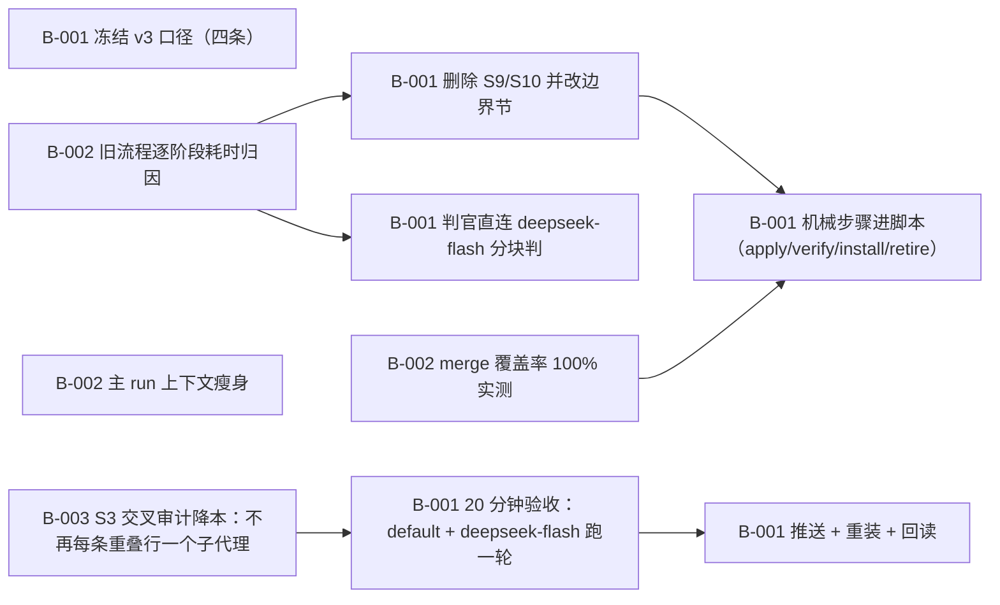

# Dream v3：一轮 ≤20 分钟（砍掉 skill-pack 优化步骤）

> 把 dream 重做成一小时以内可跑完的一轮：default profile + deepseek-flash 跑完整流程（枚举 → 判落点 → 交叉审计 → 写入包 → 独立验证 → 整包重装 → 退役）在 20 分钟内完成。硬口径：①不含「优化/整理 skill pack」这一步（删除 S9 全库去重+无类目归位、S10 合并/umbrella），那部分由用户正在开发的 SkillWeave 项目接手；②一轮 = 一个 profile（default），跑扫描当刻的全量 local 候选，不抽样；③判官用 deepseek-flash（JEV 451 不可用）；④判据 = wall clock ≤ 20 min，贴实测。基线：2026-10-11 两轮实测都超 4 小时（04:00 轮 4h50m 失败；09:07 轮 ≥4h37m 未完，provider 流断拖死）。

**进度** 3/10 块（30%） · 状态 `active` · 更新于 2026-10-11 14:32

**参与方** 本人(human)

## 现在该谁动（NOW / NEXT）

- `T-003#B-001` **判官直连 deepseek-flash 分块判** — 待认领 · @未指派
- `T-003#B-002` **merge 覆盖率 100% 实测** — 待认领 · @未指派

## 图

## 任务

### T-001 定界与基线（口径冻结 + 旧流程实测数字） — 已完成
- [x] `T-001#B-001` **冻结 v3 口径（四条）** _decision_ — 已完成
    - 做什么：把用户 2026-10-11 的四条口径写进 docs/scope.md：①不含「优化/整理 skill pack」这一步，SkillWeave 接手；②一轮 = 一个 profile（default），跑扫描当刻全量 local 候选，不抽样；③判官用 deepseek-flash（JEV 451 不可用）；④判据 = wall clock ≤ 20 min。并在 plan 里 note --kind decision 记一条。
    - 判据：docs/scope.md 存在且四条口径逐条在位；loomerto block show 读得到该 doc；git show --stat 里能看到 docs/scope.md。
    - 产物：`docs/scope.md`
    - run 2026-10-11 13:54 default pending→done 四条口径已写进 docs/scope.md 并冻结（不含 skill-pack 优化 / 一轮一个 profile 全量候选 / 判官 deepseek-flash / 判据 20min wall）。
- [x] `T-001#B-002` **旧流程逐阶段耗时归因** _research_ — 已完成
    - 做什么：取 2026-10-11 两轮实测（04:00 轮 4h50m 失败；09:07 轮 ≥4h37m 未完）＋ plans/dream-perf 的 T-001/T-002/T-004/T-006/T-008/T-009 结论，写成 docs/baseline-v2.md：逐阶段（枚举/判官/审计/写入/验证/重装/退役）的实测耗时与主因，标出哪几条在 v3 被砍掉或被脚本化。
    - 判据：docs/baseline-v2.md 有逐阶段表（阶段 / 实测耗时或证据 / 主因 / v3 处置），每行带证据路径（如 plans/dream-perf/evidence/rounds.jsonl 的行时间戳）。
    - 产物：`docs/baseline-v2.md`
    - run 2026-10-11 14:05 default pending→done 逐阶段归因表落盘：两轮实测（04:00 轮 4h50m 失败 = 子代理等模型响应 15910.8s 被中断；09:07 轮 ≥4h57m 未完）；S1–S8 每阶段的主因与 v3 处置；三条横切（provider 流断 / 环境目录被回收 / cron 审批闸）。基线暴露一个缺口：S3 交叉审计在 v2 里是每行一个子代理，v3 还没有降本块 —— 已补 T-004#B-003。commit 在分支 dream-v3。

### T-002 砍步骤：删掉 S9/S10（skill-pack 优化） — 已完成
前置 T-001
- [x] `T-002#B-001` **删除 S9/S10 并改边界节** _impl_ — 已完成
    - 做什么：在 skills/dream/SKILL.md（边界节、检查点、反例）、references/dream-method.md、README.md 里删掉 S9（全库去重 + 无类目归位）与 S10（合并/umbrella）；边界节写明「不属于本 skill：skill-pack 优化/整理 → SkillWeave（用户在建）」；sweep-plan.py 的 dedupe 子命令一并删除（连同它的自检）。
    - 判据：三处文件不再有 S9/S10 的步骤定义（grep 结果原文）；python3 -B skills/dream/scripts/check-disclosure.py skills/dream exit 0；sweep-plan.py --help 只剩新版子命令；README 索引表已同步。
    - 依赖：T-001#B-001（任务级）
    - 依赖：T-001#B-002（任务级）
    - 产物：`skills/dream/scripts/sweep-plan.py`
    - 产物：`skills/dream/SKILL.md`
    - run 2026-10-11 14:02 default pending→done S9/S10 全删：dedupe 子命令与 _suggest_category 移除（-252 行）、SKILL.md 删两节+分工表那行+加边界排除、method.md 删 s9/s10、routing 删 umbrella 落值、README 修过期引用。证据：--self-test OK、--help 只剩 scan/merge、check-disclosure 通过、grep 无残留。commit 5b957be（分支 dream-v3）。
    - run 2026-10-11 14:02 default done→done 第二条证据：边界节新增「技能库/pack 的整理与优化（合并/umbrella/副本清退/无类目归位）→ SkillWeave」，文档树与 Support files 同步为 S1–S8。

### T-003 判官换 deepseek-flash（JEV 451 不用） — 待认领
前置 T-001
- [ ] `T-003#B-001` **判官直连 deepseek-flash 分块判** _impl_ — 待认领
    - 做什么：去掉 JEV 依赖与「每 8–12 条一个判官子代理」的接线，改为主 agent 直接对 judge-input-bodies.json 分块调 deepseek-flash（每块若干条、正文内联），产物仍是 verdicts-*.jsonl；dream-hermes-routing 里写明这条改法与 JEV 451 的历史。
    - 判据：对 default 全量候选实际产出 verdicts-*.jsonl，条数 = 扫描候选数；贴分块数、每块条数与判定总耗时。
    - 依赖：T-001#B-001（任务级）
    - 依赖：T-001#B-002（任务级）
- [ ] `T-003#B-002` **merge 覆盖率 100% 实测** _impl_ — 待认领
    - 做什么：对 default 跑 sweep-plan.py merge，确认没有未判定/被拒收的行。
    - 判据：贴命令与输出，exit 0（不出现 exit 4），plan.md 与 install-cmds.sh 生成。
    - 依赖：T-001#B-001（任务级）
    - 依赖：T-001#B-002（任务级）

### T-004 机械步骤脚本化：写入/验证/重装/退役 — 待排
前置 T-002, T-003
- [ ] `T-004#B-001` **机械步骤进脚本（apply/verify/install/retire）** _impl_ — 等前置
    - 做什么：把 S5 写入 / S6 验证 / S7 整包重装 / S8 退役 做进脚本子命令（apply / verify / install / retire），主 agent 只发一条命令并读摘要；只有写不出正确形态的行才回退一个子代理。写入按 pathspec、push origin <sha>:main、不动别人的在途文件。
    - 判据：一轮里：写入+提交+推送由一条命令完成，装回回读与退役各一条命令完成；贴四条命令与输出；无残留临时文件。
    - 依赖：T-002#B-001（任务级）
    - 依赖：T-003#B-001（任务级）
    - 依赖：T-003#B-002（任务级）
- [ ] `T-004#B-002` **主 run 上下文瘦身** _impl_ — 等前置
    - 做什么：主 run 禁读 sweep-plan.py 全文（沿用 plans/dream-perf T-001#B-001 的结论），每步只留「一条命令 + 一段摘要」，脚本用法下沉 references。
    - 判据：贴一轮的每次调用 prompt 峰值与最大单条工具结果；无 >40KB 的上下文炸弹。
    - 依赖：T-002#B-001（任务级）
    - 依赖：T-003#B-001（任务级）
    - 依赖：T-003#B-002（任务级）
- [ ] `T-004#B-003` **S3 交叉审计降本：不再每条重叠行一个子代理** _impl_ — 等前置
    - 做什么：v2 的 S3 对「落点=已有技能」的每一行派一个只读子代理（第二次扇出）。20 分钟目标下这一步要降本，候选做法（要拿实测选，不许拍脑袋）：①把已证明重叠的行并进判官同一批调用；②先用脚本按 claim 逐条 grep 出候选命中，再只对命中行做一次批量判断；③合并成 1–2 个子代理分块处理。判据：本轮 S3 的 wall 与调用数要落进 20 分钟预算，且 already-there / net-new 两张清单的证据格式（接收侧 file:line）不变。
    - 判据：贴选定的做法 + 本轮 S3 的实测 wall 与 LLM 调用数；同一批重叠行在降本前后各出一份清单，形状一致（接收侧 file:line 齐全）。
    - 依赖：T-002#B-001（任务级）
    - 依赖：T-003#B-001（任务级）
    - 依赖：T-003#B-002（任务级）

### T-005 20 分钟验收（default + deepseek-flash 跑一轮） — 待排
前置 T-004
- [ ] `T-005#B-001` **20 分钟验收：default + deepseek-flash 跑一轮** _impl_ — 等前置
    - 做什么：用 default profile + deepseek-flash 跑一轮完整 v3 流程（枚举 → 判落点 → 交叉审计 → 写入 → 独立验证 → 整包重装 → 退役），逐阶段计时。
    - 判据：wall clock ≤ 20 min 的实测（起止时间戳 + 逐阶段耗时表）；该轮结束时所有 local 候选都有落点（not_in_pack=0，或按 v3 口径写明的等价判据）。
    - 依赖：T-004#B-001（任务级）
    - 依赖：T-004#B-002（任务级）
    - 依赖：T-004#B-003（任务级）

### T-006 推送 + 重装两个 skill + 回读 — 待排
前置 T-005
- [ ] `T-006#B-001` **推送 + 重装 + 回读** _impl_ — 等前置
    - 做什么：git push origin <sha>:main；hermes skills install/update flmaximwang/Dream/skills/dream 与 dream-hermes-routing（用 default profile 的已装版本做回读）。
    - 判据：推送 sha 与 origin/main 回读一致；hermes skills list 里两条都在；lock.json 的 identifier 指向 flmaximwang/Dream/skills/<名>。
    - 依赖：T-005#B-001（任务级）

## 日志（近 20 条）

- `2026-10-11 13:53` **agent** [task] 新增任务 T-004「机械步骤脚本化：写入/验证/重装/退役」
- `2026-10-11 13:53` **agent** [task] 新增任务 T-005「20 分钟验收（default + deepseek-flash 跑一轮）」
- `2026-10-11 13:53` **agent** [task] 新增任务 T-006「推送 + 重装两个 skill + 回读」
- `2026-10-11 13:53` **agent** [block] 新增块 T-001#B-001「冻结 v3 口径（四条）」
- `2026-10-11 13:53` **agent** [block] 新增块 T-001#B-002「旧流程逐阶段耗时归因」
- `2026-10-11 13:53` **agent** [block] 新增块 T-002#B-001「删除 S9/S10 并改边界节」
- `2026-10-11 13:53` **agent** [block] 新增块 T-003#B-001「判官直连 deepseek-flash 分块判」
- `2026-10-11 13:53` **agent** [block] 新增块 T-003#B-002「merge 覆盖率 100% 实测」
- `2026-10-11 13:53` **agent** [block] 新增块 T-004#B-001「机械步骤进脚本（apply/verify/install/retire）」
- `2026-10-11 13:53` **agent** [block] 新增块 T-004#B-002「主 run 上下文瘦身」
- `2026-10-11 13:53` **agent** [block] 新增块 T-005#B-001「20 分钟验收：default + deepseek-flash 跑一轮」
- `2026-10-11 13:53` **agent** [block] 新增块 T-006#B-001「推送 + 重装 + 回读」
- `2026-10-11 13:54` **agent** [status] T-001#B-001: pending → done（四条口径已写进 docs/scope.md 并冻结（不含 skill-pack 优化 / 一轮一个 profile 全量候选 / 判官 deepseek-flash / 判据 20min wall）。）
- `2026-10-11 13:54` **agent** [decision] v3 口径冻结（2026-10-11 用户指示）：dream 不再做 skill-pack 的整理/优化（S9/S10 删掉，SkillWeave 接手）；一轮 = 一个 profile 的全量候选；判官用 deepseek-flash；验收 = ≤20min wall。另发现一处过期引用：README 索引表指向 docs/acceptance.md，但 docs/ 里没有这个文件（docs/ 原本是空的）—— 待 T-002 一并处理。
- `2026-10-11 14:01` **agent** [decision] 开发在 worktree 里做（用户 2026-10-11 要求优先 worktree）：worktree = /Users/maxim/Repositories/Repo/Dream.wt-v3，分支 dream-v3，本次提交 5b957be。**未 push**：主 clone 的 main 领先 origin 7 条，其中含别人的在途提交，按规矩不代推 —— push 留给那些提交的主人（或用户指定）。后续块继续在这个 worktree 里做。
- `2026-10-11 14:02` **agent** [status] T-002#B-001: pending → done（S9/S10 全删：dedupe 子命令与 _suggest_category 移除（-252 行）、SKILL.md 删两节+分工表那行+加边界排除、method.md 删 s9/s10、routing 删 umbrella 落值、README 修过期引用。证据：--self-test OK、--help 只剩 scan/merge、check-disclosure 通过、grep 无残留。commit 5b957be（分支 dream-v3）。）
- `2026-10-11 14:02` **agent** [status] T-002#B-001: done → done（第二条证据：边界节新增「技能库/pack 的整理与优化（合并/umbrella/副本清退/无类目归位）→ SkillWeave」，文档树与 Support files 同步为 S1–S8。）
- `2026-10-11 14:05` **agent** [status] T-001#B-002: pending → done（逐阶段归因表落盘：两轮实测（04:00 轮 4h50m 失败 = 子代理等模型响应 15910.8s 被中断；09:07 轮 ≥4h57m 未完）；S1–S8 每阶段的主因与 v3 处置；三条横切（provider 流断 / 环境目录被回收 / cron 审批闸）。基线暴露一个缺口：S3 交叉审计在 v2 里是每行一个子代理，v3 还没有降本块 —— 已补 T-004#B-003。commit 在分支 dream-v3。）
- `2026-10-11 14:05` **agent** [block] 新增块 T-004#B-003「S3 交叉审计降本：不再每条重叠行一个子代理」
- `2026-10-11 14:32` **agent** [decision] 判官实测（14:15-14:32）：scan 10.4s（99 候选 / 1.32MB 正文）→ 8 块（每块 ~20-210KB）。单块 141KB 烟测 53.8s 出 5/5 合格 verdict。第一次整批跑（3 workers）时 3 块 ~140KB 的请求同时被 `URLError: Connection reset by peer`（Errno 54）打掉，verdicts 只落 48/99 —— 端点对大并发大请求会 reset。处置：judge.py 加 3 次退避重试（5s/10s），并把并发降到 2；同时把「只在最后写 verdicts」改成每块落地 + 断点续跑（被掐不再白付）。当前 48/99，续跑中（proc_1c7ca25aca74）。

---
plan.json 是唯一真相；本文件与 plan.html / plan.canvas 由 `plan.py render dream-v3` 生成。
