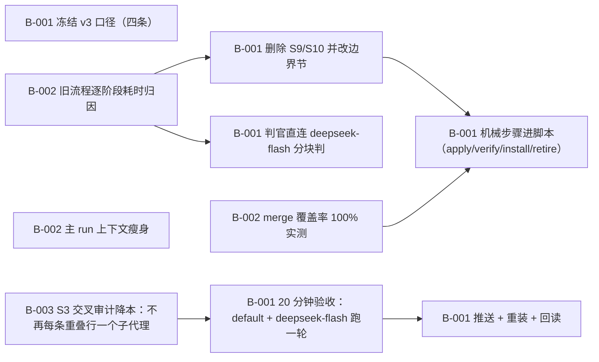

# Dream v3：一轮 ≤20 分钟（砍掉 skill-pack 优化步骤）

> 把 dream 重做成一小时以内可跑完的一轮：default profile + deepseek-flash 跑完整流程（枚举 → 判落点 → 交叉审计 → 写入包 → 独立验证 → 整包重装 → 退役）在 20 分钟内完成。硬口径：①不含「优化/整理 skill pack」这一步（删除 S9 全库去重+无类目归位、S10 合并/umbrella），那部分由用户正在开发的 SkillWeave 项目接手；②一轮 = 一个 profile（default），跑扫描当刻的全量 local 候选，不抽样；③判官用 deepseek-flash（JEV 451 不可用）；④判据 = wall clock ≤ 20 min，贴实测。基线：2026-10-11 两轮实测都超 4 小时（04:00 轮 4h50m 失败；09:07 轮 ≥4h37m 未完，provider 流断拖死）。

**进度** 6/10 块（60%） · 状态 `active` · 更新于 2026-10-11 15:37

**参与方** 本人(human)

## 现在该谁动（NOW / NEXT）

- `T-004#B-001` **机械步骤进脚本（apply/verify/install/retire）** — 进行中 · @default · 在做 @default
- `T-004#B-002` **主 run 上下文瘦身** — 待认领 · @未指派

## 图

## 任务

### T-001 定界与基线（口径冻结 + 旧流程实测数字） — 已完成
- [x] `T-001#B-001` **冻结 v3 口径（四条）** _decision_ — 已完成
    - 做什么：把用户 2026-10-11 的四条口径写进 docs/scope.md：①不含「优化/整理 skill pack」这一步，SkillWeave 接手；②一轮 = 一个 profile（default），跑扫描当刻全量 local 候选，不抽样；③判官用 deepseek-flash（JEV 451 不可用）；④判据 = wall clock ≤ 20 min。并在 plan 里 note --kind decision 记一条。
    - 判据：docs/scope.md 存在且四条口径逐条在位；loomerto block show 读得到该 doc；git show --stat 里能看到 docs/scope.md。
    - 产物：`docs/scope.md`
    - run 2026-10-11 13:54 default pending→done 四条口径已写进 docs/scope.md 并冻结（不含 skill-pack 优化 / 一轮一个 profile 全量候选 / 判官 deepseek-flash / 判据 20min wall）。
- [x] `T-001#B-002` **旧流程逐阶段耗时归因** _research_ — 已完成
    - 做什么：取 2026-10-11 两轮实测（04:00 轮 4h50m 失败；09:07 轮 ≥4h37m 未完）＋ plans/dream-perf 的 T-001/T-002/T-004/T-006/T-008/T-009 结论，写成 docs/baseline-v2.md：逐阶段（枚举/判官/审计/写入/验证/重装/退役）的实测耗时与主因，标出哪几条在 v3 被砍掉或被脚本化。
    - 判据：docs/baseline-v2.md 有逐阶段表（阶段 / 实测耗时或证据 / 主因 / v3 处置），每行带证据路径（如 plans/dream-perf/evidence/rounds.jsonl 的行时间戳）。
    - 产物：`docs/baseline-v2.md`
    - run 2026-10-11 14:05 default pending→done 逐阶段归因表落盘：两轮实测（04:00 轮 4h50m 失败 = 子代理等模型响应 15910.8s 被中断；09:07 轮 ≥4h57m 未完）；S1–S8 每阶段的主因与 v3 处置；三条横切（provider 流断 / 环境目录被回收 / cron 审批闸）。基线暴露一个缺口：S3 交叉审计在 v2 里是每行一个子代理，v3 还没有降本块 —— 已补 T-004#B-003。commit 在分支 dream-v3。

### T-002 砍步骤：删掉 S9/S10（skill-pack 优化） — 已完成
前置 T-001
- [x] `T-002#B-001` **删除 S9/S10 并改边界节** _impl_ — 已完成
    - 做什么：在 skills/dream/SKILL.md（边界节、检查点、反例）、references/dream-method.md、README.md 里删掉 S9（全库去重 + 无类目归位）与 S10（合并/umbrella）；边界节写明「不属于本 skill：skill-pack 优化/整理 → SkillWeave（用户在建）」；sweep-plan.py 的 dedupe 子命令一并删除（连同它的自检）。
    - 判据：三处文件不再有 S9/S10 的步骤定义（grep 结果原文）；python3 -B skills/dream/scripts/check-disclosure.py skills/dream exit 0；sweep-plan.py --help 只剩新版子命令；README 索引表已同步。
    - 依赖：T-001#B-001（任务级）
    - 依赖：T-001#B-002（任务级）
    - 产物：`skills/dream/scripts/sweep-plan.py`
    - 产物：`skills/dream/SKILL.md`
    - run 2026-10-11 14:02 default pending→done S9/S10 全删：dedupe 子命令与 _suggest_category 移除（-252 行）、SKILL.md 删两节+分工表那行+加边界排除、method.md 删 s9/s10、routing 删 umbrella 落值、README 修过期引用。证据：--self-test OK、--help 只剩 scan/merge、check-disclosure 通过、grep 无残留。commit 5b957be（分支 dream-v3）。
    - run 2026-10-11 14:02 default done→done 第二条证据：边界节新增「技能库/pack 的整理与优化（合并/umbrella/副本清退/无类目归位）→ SkillWeave」，文档树与 Support files 同步为 S1–S8。

### T-003 判官换 deepseek-flash（JEV 451 不用） — 已完成
前置 T-001
- [x] `T-003#B-001` **判官直连 deepseek-flash 分块判** _impl_ — 已完成
    - 做什么：去掉 JEV 依赖与「每 8–12 条一个判官子代理」的接线，改为主 agent 直接对 judge-input-bodies.json 分块调 deepseek-flash（每块若干条、正文内联），产物仍是 verdicts-*.jsonl；dream-hermes-routing 里写明这条改法与 JEV 451 的历史。
    - 判据：对 default 全量候选实际产出 verdicts-*.jsonl，条数 = 扫描候选数；贴分块数、每块条数与判定总耗时。
    - 依赖：T-001#B-001（任务级）
    - 依赖：T-001#B-002（任务级）
    - 产物：`skills/dream/scripts/judge.py`
    - 产物：`skills/dream/references/dream-judge-routing.md`
    - run 2026-10-11 14:47 default pending→done 判官换成 judge.py 分块直调 deepseek-flash：99/99 verdicts，8 块（12KB–138KB），总耗时 341.6s（新题面全重判；含缓存的首跑 166s）。JEV 探活与判官子代理降级链已删。
    - run 2026-10-11 14:47 default done→done 第二条证据：题面改成 dest_space（含各目录现有技能清单），否则 merge/strengthen 的 dest_skill 会被凭空编出、被 merge 拒收。
- [x] `T-003#B-002` **merge 覆盖率 100% 实测** _impl_ — 已完成
    - 做什么：对 default 跑 sweep-plan.py merge，确认没有未判定/被拒收的行。
    - 判据：贴命令与输出，exit 0（不出现 exit 4），plan.md 与 install-cmds.sh 生成。
    - 依赖：T-001#B-001（任务级）
    - 依赖：T-001#B-002（任务级）
    - 产物：`/Users/maxim/.hermes/cache/scratch/sweep-v3/plan.md`
    - run 2026-10-11 14:47 default pending→done merge exit 0（覆盖率 100%，无 exit 4）：plan.md 43KB / resolved.json / install-cmds.sh 生成；命中 16 个包、拟建 12 个新包（只报不建）。99 条里 existing 86 / new 13，action move 75 / merge 11；15 条 confidence<0.6 进 S3 复核队列。

### T-004 机械步骤脚本化：写入/验证/重装/退役 — 进行中
前置 T-002, T-003
- [ ] `T-004#B-001` **机械步骤进脚本（apply/verify/install/retire）** _impl_ — 进行中 @default
    - 做什么：把 S5 写入 / S6 验证 / S7 整包重装 / S8 退役 做进脚本子命令（apply / verify / install / retire），主 agent 只发一条命令并读摘要；只有写不出正确形态的行才回退一个子代理。写入按 pathspec、push origin <sha>:main、不动别人的在途文件。
    - 判据：一轮里：写入+提交+推送由一条命令完成，装回回读与退役各一条命令完成；贴四条命令与输出；无残留临时文件。
    - 依赖：T-002#B-001（任务级）
    - 依赖：T-003#B-001（任务级）
    - 依赖：T-003#B-002（任务级）
    - 在做：@default
    - run 2026-10-11 14:55 default pending→running apply.py 落地（commit bb1f200）：apply/verify/install/retire 四个子命令 + --self-test。实测三条：① safe 行在 throwaway 包上写入成功（commit 只含该技能目录，--no-push）；② 两条非 safe（caution/dangerous）被扫描闸挡住、工作区无残留；③ verify 在未推送时正确报 FAIL（dir=True / origin/main=False / diff 未装）。差最后一步：真写整批（75 行 move+__new__）要在一轮里跑，留在 T-005。
    - run 2026-10-11 15:13 default running→running 按用户口径在 AgentSkill-copy 副本上整批实测（副本已删）：apply 全批 75 行耗时 7.6s → 写入 49 行（每包一次 pathspec commit）、scan 闸挡下 4 行（P2 dangerous、P12/P5/P35 caution）、UsingHermes 因工作区有别人的改动跳过 19 行、WebInspection 非 git 仓跳过 1 行；verify PASS 49 / FAIL 0（dir + sha；diff 如预期显示未 install）。真包工作区除 UsingHermes 的在途改动外全为 0 改动。修了两处真 bug：sha 前缀比（git log --oneline 只印 7 位 → 假 FAIL）、无远端时退回本地 HEAD。差：真推与 retire 未测（retire 会删 profile 真副本，不拿它当测试面）。
- [ ] `T-004#B-002` **主 run 上下文瘦身** _impl_ — 待认领
    - 做什么：主 run 禁读 sweep-plan.py 全文（沿用 plans/dream-perf T-001#B-001 的结论），每步只留「一条命令 + 一段摘要」，脚本用法下沉 references。
    - 判据：贴一轮的每次调用 prompt 峰值与最大单条工具结果；无 >40KB 的上下文炸弹。
    - 依赖：T-002#B-001（任务级）
    - 依赖：T-003#B-001（任务级）
    - 依赖：T-003#B-002（任务级）
    - run 2026-10-11 15:03 default pending→running 先落了 s8 汇报口径（只读落点 vs 真写入分开写，commit 见 worktree）；同块的正文瘦身未动。
- [x] `T-004#B-003` **S3 交叉审计降本：不再每条重叠行一个子代理** _impl_ — 已完成 @default
    - 做什么：v2 的 S3 对「落点=已有技能」的每一行派一个只读子代理（第二次扇出）。20 分钟目标下这一步要降本，候选做法（要拿实测选，不许拍脑袋）：①把已证明重叠的行并进判官同一批调用；②先用脚本按 claim 逐条 grep 出候选命中，再只对命中行做一次批量判断；③合并成 1–2 个子代理分块处理。判据：本轮 S3 的 wall 与调用数要落进 20 分钟预算，且 already-there / net-new 两张清单的证据格式（接收侧 file:line）不变。
    - 判据：贴选定的做法 + 本轮 S3 的实测 wall 与 LLM 调用数；同一批重叠行在降本前后各出一份清单，形状一致（接收侧 file:line 齐全）。
    - 依赖：T-002#B-001（任务级）
    - 依赖：T-003#B-001（任务级）
    - 依赖：T-003#B-002（任务级）
    - 产物：`skills/dream/scripts/audit.py`
    - run 2026-10-11 15:26 default pending→running 选定做法（①+② 合体）：判官在 S2 同一批里逐字抄 3–8 条 claims（不给就退回重判，校验已进 judge.py），audit.py 拿 claims 去接收技能目录 grep -nF → 命中给 file:line、未命中进 net-new，全员未命中标 ⚠（落点存疑）。LLM 调用 0（v2 是每条重叠行一个子代理=第二次扇出），证据是 grep 真输出。判官已按新题面重跑中（后台 proc_d87619f42911），跑完 audit.py 出两份形状一致的清单 + wall/调用数。
    - run 2026-10-11 15:37 default running→done 选定做法＝①+②合体：claims 随 S2 同一批返回（判官只抄串、脚本负责证明），audit.py grep 出接收侧 file:line。实测（default profile 全量 99 候选 / 25 条重叠行）：S3 = 0 次 LLM 调用、wall 1.5s、160 条 claims、already-there 38 条带 file:line（如 SKILL.md:44、references/install-a-hermes-plugin-dependency-resolution.md:12）、落点不存在 0、全净新增 10 行（都是 merge，正常形状）。v2 同批要 25 个只读子代理（每条重叠行一个）。形状复核：P1 用 v2 的做法手工做了一遍（源侧抄出 7 条旗标=判官 claims 全对，接收侧逐条 grep），与 audit.py 判定逐条一致（1 命中/6 净新增）。

### T-005 20 分钟验收（default + deepseek-flash 跑一轮） — 待排
前置 T-004
- [ ] `T-005#B-001` **20 分钟验收：default + deepseek-flash 跑一轮** _impl_ — 等前置
    - 做什么：用 default profile + deepseek-flash 跑一轮完整 v3 流程（枚举 → 判落点 → 交叉审计 → 写入 → 独立验证 → 整包重装 → 退役），逐阶段计时。
    - 判据：wall clock ≤ 20 min 的实测（起止时间戳 + 逐阶段耗时表）；该轮结束时所有 local 候选都有落点（not_in_pack=0，或按 v3 口径写明的等价判据）。
    - 依赖：T-004#B-001（任务级）
    - 依赖：T-004#B-002（任务级）
    - 依赖：T-004#B-003（任务级）

### T-006 推送 + 重装两个 skill + 回读 — 待排
前置 T-005
- [ ] `T-006#B-001` **推送 + 重装 + 回读** _impl_ — 等前置
    - 做什么：git push origin <sha>:main；hermes skills install/update flmaximwang/Dream/skills/dream 与 dream-hermes-routing（用 default profile 的已装版本做回读）。
    - 判据：推送 sha 与 origin/main 回读一致；hermes skills list 里两条都在；lock.json 的 identifier 指向 flmaximwang/Dream/skills/<名>。
    - 依赖：T-005#B-001（任务级）

## 日志（近 20 条）

- `2026-10-11 14:05` **agent** [block] 新增块 T-004#B-003「S3 交叉审计降本：不再每条重叠行一个子代理」
- `2026-10-11 14:32` **agent** [decision] 判官实测（14:15-14:32）：scan 10.4s（99 候选 / 1.32MB 正文）→ 8 块（每块 ~20-210KB）。单块 141KB 烟测 53.8s 出 5/5 合格 verdict。第一次整批跑（3 workers）时 3 块 ~140KB 的请求同时被 `URLError: Connection reset by peer`（Errno 54）打掉，verdicts 只落 48/99 —— 端点对大并发大请求会 reset。处置：judge.py 加 3 次退避重试（5s/10s），并把并发降到 2；同时把「只在最后写 verdicts」改成每块落地 + 断点续跑（被掐不再白付）。当前 48/99，续跑中（proc_1c7ca25aca74）。
- `2026-10-11 14:41` **agent** [decision] 判官路径第一版跑通（99/99，166s），但 merge 拒收 10 行 → 两个真缺陷，都已修：① 每块的中间产物我命名成 verdicts-chunk-*.jsonl，正好被 merge 的 verdicts*.jsonl 通配吃掉 ⇒ 变成 109 条重复 verdict（exit 4）；改名 judge-verdicts-chunk-*.jsonl。② 判官题面只给了 290 个目录名、没给**各目录的现有技能清单**，于是 merge/strengthen 的 dest_skill 被它编出来（如 AgentSkill-ObsidianManagement 下的 relayer-clc-classification-paths）⇒ 10 行被拒。改成 dest_space()：工具/主题轴 + 每个非空目录的现有技能名（18.8KB），并在题面写明「dest_skill 必须是列出的名字之一，没有就退回 move + __new__」。另加一道缓存闸：断点续跑要求 prompt sha 逐字节相同，改了题面不会被旧回复静默复用。当前改完题面重判中（proc_aa397cad76da）。
- `2026-10-11 14:47` **agent** [status] T-003#B-002: pending → done（merge exit 0（覆盖率 100%，无 exit 4）：plan.md 43KB / resolved.json / install-cmds.sh 生成；命中 16 个包、拟建 12 个新包（只报不建）。99 条里 existing 86 / new 13，action move 75 / merge 11；15 条 confidence<0.6 进 S3 复核队列。）
- `2026-10-11 14:47` **agent** [decision] T-003 收工：S2 现在是「跑一条命令」——judge.py 99 条 8 块、2 worker 341.6s（并发 3 会撞 Connection reset，已加退避重试并把默认并发降到 2）。S2 的 wall 从 v2 的一整次扇出（10 个子代理）压到分钟级；下一步 T-004 把 S5/S6/S7/S8 也脚本化，并处理 T-004#B-003（S3 每条重叠行一个子代理）。
- `2026-10-11 14:47` **agent** [status] T-003#B-001: pending → done（判官换成 judge.py 分块直调 deepseek-flash：99/99 verdicts，8 块（12KB–138KB），总耗时 341.6s（新题面全重判；含缓存的首跑 166s）。JEV 探活与判官子代理降级链已删。）
- `2026-10-11 14:47` **agent** [status] T-003#B-001: done → done（第二条证据：题面改成 dest_space（含各目录现有技能清单），否则 merge/strengthen 的 dest_skill 会被凭空编出、被 merge 拒收。）
- `2026-10-11 14:55` **agent** [status] T-004#B-001: pending → running（apply.py 落地（commit bb1f200）：apply/verify/install/retire 四个子命令 + --self-test。实测三条：① safe 行在 throwaway 包上写入成功（commit 只含该技能目录，--no-push）；② 两条非 safe（caution/dangerous）被扫描闸挡住、工作区无残留；③ verify 在未推送时正确报 FAIL（dir=True / origin/main=False / diff 未装）。差最后一步：真写整批（75 行 move+__new__）要在一轮里跑，留在 T-005。）
- `2026-10-11 14:55` **agent** [decision] apply.py 的机械面已定形：resolved.json 的 dest 是**摊平在顶层**的（repo/kind/dest_skill/action），不是嵌套 —— 按嵌套读会一行都匹配不到（自检里抓到的第一个真 bug）。第三条：扫闸（tools.skills_guard）会真的挡住 caution/dangerous，脚本按「回滚拷贝+不提交」处理，不留工作区残留。
- `2026-10-11 14:55` **agent** [assign] T-004#B-001 指派给 default（由本会话（default profile 的 agent）在做）
- `2026-10-11 15:03` **agent** [status] T-004#B-002: pending → running（先落了 s8 汇报口径（只读落点 vs 真写入分开写，commit 见 worktree）；同块的正文瘦身未动。）
- `2026-10-11 15:03` **agent** [exec] T-004#B-002: 线程登记已清除（@default 收工）
- `2026-10-11 15:03` **agent** [status] T-004#B-002: running → pending（回退：刚才误记到这里（s8 汇报口径不是「上下文瘦身」），仍在待办。）
- `2026-10-11 15:03` **agent** [decision] s8 汇报口径补进 dream-method.md（worktree commit 8930571）：只读落点数据与真写入必须分开写、写入为 0 就明写「0 个包被改动」。起因：本轮汇报把只读的包名和真写入混写，用户误以为我擅自改了包。
- `2026-10-11 15:13` **agent** [status] T-004#B-001: running → running（按用户口径在 AgentSkill-copy 副本上整批实测（副本已删）：apply 全批 75 行耗时 7.6s → 写入 49 行（每包一次 pathspec commit）、scan 闸挡下 4 行（P2 dangerous、P12/P5/P35 caution）、UsingHermes 因工作区有别人的改动跳过 19 行、WebInspection 非 git 仓跳过 1 行；verify PASS 49 / FAIL 0（dir + sha；diff 如预期显示未 install）。真包工作区除 UsingHermes 的在途改动外全为 0 改动。修了两处真 bug：sha 前缀比（git log --oneline 只印 7 位 → 假 FAIL）、无远端时退回本地 HEAD。差：真推与 retire 未测（retire 会删 profile 真副本，不拿它当测试面）。）
- `2026-10-11 15:23` **agent** [decision] 用户定案（2026-10-11）：包仓库是测试面 ⇒ 开发期一律 --no-push，测试轮跑到 verify 就停、不推不 retire；真推与退役留给正式轮。Dream 仓库开发完成后把 dream-v3 与主 clone 上别人的提交合并再按指示推。已写进 docs/scope.md §5。
- `2026-10-11 15:26` **agent** [status] T-004#B-003: pending → running（选定做法（①+② 合体）：判官在 S2 同一批里逐字抄 3–8 条 claims（不给就退回重判，校验已进 judge.py），audit.py 拿 claims 去接收技能目录 grep -nF → 命中给 file:line、未命中进 net-new，全员未命中标 ⚠（落点存疑）。LLM 调用 0（v2 是每条重叠行一个子代理=第二次扇出），证据是 grep 真输出。判官已按新题面重跑中（后台 proc_d87619f42911），跑完 audit.py 出两份形状一致的清单 + wall/调用数。）
- `2026-10-11 15:26` **agent** [assign] T-004#B-003 指派给 default（本会话在做）
- `2026-10-11 15:37` **agent** [exec] T-004#B-003: 线程登记已清除（@default 收工）
- `2026-10-11 15:37` **agent** [status] T-004#B-003: running → done（选定做法＝①+②合体：claims 随 S2 同一批返回（判官只抄串、脚本负责证明），audit.py grep 出接收侧 file:line。实测（default profile 全量 99 候选 / 25 条重叠行）：S3 = 0 次 LLM 调用、wall 1.5s、160 条 claims、already-there 38 条带 file:line（如 SKILL.md:44、references/install-a-hermes-plugin-dependency-resolution.md:12）、落点不存在 0、全净新增 10 行（都是 merge，正常形状）。v2 同批要 25 个只读子代理（每条重叠行一个）。形状复核：P1 用 v2 的做法手工做了一遍（源侧抄出 7 条旗标=判官 claims 全对，接收侧逐条 grep），与 audit.py 判定逐条一致（1 命中/6 净新增）。）

---
plan.json 是唯一真相；本文件与 plan.html / plan.canvas 由 `plan.py render dream-v3` 生成。
