# 与 SkillWeave 的边界移交：包内结构整理退出 dream

> 让 dream 只做「把没有仓库归属的本地技能收编进包 + profile 级读数与闸门」，把「包内结构整理」整体移交给 SkillWeave，并把这件事做到底（正文、脚本、依赖点、README、既有计划全部对齐）。

**进度** 0/15 块（0%） · 状态 `active` · 更新于 2026-10-11 17:41

**参与方** 本人(human)

## 现在该谁动（NOW / NEXT）

- `T-001#B-001` **复现 dream-v3#T-002#B-001 的 done_when：哪几条现在不成立** — 已认领 · @dream-dev
- `T-002#B-001` **删 `skills/dream/SKILL.md` 的 S9/S10 两节，改成一行转指** — 已认领 · @dream-dev
- `T-002#B-002` **`sweep-plan.py` 删掉 `dedupe` 子命令（含 --fix-no-category 与它的自检）** — 已认领 · @dream-dev
- `T-002#B-003` **改 `dream-hermes-routing` 里指向 S10 的转指** — 已认领 · @dream-dev
- `T-002#B-004` **`check-disclosure.py` 与 README 的长度/披露常量一并移交** — 已认领 · @dream-dev
- `T-002#B-005` **`docs/scope.md` §① 与 README 边界表改成「已移交」并写死 SkillWeave 入口** — 已认领 · @dream-dev
- `T-003#B-001` **S7 装前的总量闸门：装完后 profile 技能总数 ≤ 120（MAX_AGENT_SKILLS）** — 已认领 · @dream-dev
- `T-003#B-002` **S7 装后的形状断言：每个技能都在类目下 + local = 0** — 已认领 · @dream-dev
- `T-003#B-003` **常量表只留 profile 侧那一个，并注明口径不重复实现** — 已认领 · @dream-dev
- `T-004#B-001` **产物里记 `input_commit` + 输入文件 digest；上游变了就标 stale** — 已认领 · @dream-dev
- `T-004#B-002` **SKILL.md 写明固定顺序与「不许越上游改同一对象」** — 已认领 · @dream-dev
- `T-005#B-001` **`skill-library-stewardship` 与本次移交冲突：改口径或作废** — 已认领 · @dream-dev
- `T-005#B-002` **按 T-001 的判定改 `dream-v3#T-002#B-001` 的状态** — 已认领 · @dream-dev
- `T-006#B-001` **在 AgentSkill-copy 上跑一轮无人值守，四条断言全过** — 已认领 · @dream-dev
- `T-006#B-002` **独立子代理复核（不许自己验自己）** — 已认领 · @dream-dev

## 图

```mermaid
flowchart LR
  T-001_B-001["B-001 复现 dream-v3#T-002#B-001 的 done_when：哪几条现在不成立"]
  T-002_B-001["B-001 删 `skills/dream/SKILL.md` 的 S9/S10 两节，改成一行转指"]
  T-002_B-002["B-002 `sweep-plan.py` 删掉 `dedupe` 子命令（含 --fix-no-category 与它的自检）"]
  T-002_B-003["B-003 改 `dream-hermes-routing` 里指向 S10 的转指"]
  T-002_B-004["B-004 `check-disclosure.py` 与 README 的长度/披露常量一并移交"]
  T-002_B-005["B-005 `docs/scope.md` §① 与 README 边界表改成「已移交」并写死 SkillWeave 入口"]
  T-003_B-001["B-001 S7 装前的总量闸门：装完后 profile 技能总数 ≤ 120（MAX_AGENT_SKILLS）"]
  T-003_B-002["B-002 S7 装后的形状断言：每个技能都在类目下 + local = 0"]
  T-003_B-003["B-003 常量表只留 profile 侧那一个，并注明口径不重复实现"]
  T-004_B-001["B-001 产物里记 `input_commit` + 输入文件 digest；上游变了就标 stale"]
  T-004_B-002["B-002 SKILL.md 写明固定顺序与「不许越上游改同一对象」"]
  T-005_B-001["B-001 `skill-library-stewardship` 与本次移交冲突：改口径或作废"]
  T-005_B-002["B-002 按 T-001 的判定改 `dream-v3#T-002#B-001` 的状态"]
  T-006_B-001["B-001 在 AgentSkill-copy 上跑一轮无人值守，四条断言全过"]
  T-006_B-002["B-002 独立子代理复核（不许自己验自己）"]
  classDef claimed stroke-width:1px;
  class T-001_B-001,T-002_B-001,T-002_B-002,T-002_B-003,T-002_B-004,T-002_B-005,T-003_B-001,T-003_B-002,T-003_B-003,T-004_B-001,T-004_B-002,T-005_B-001,T-005_B-002,T-006_B-001,T-006_B-002 claimed;
```

## 任务

### T-001 取证：已标 done 的验收今天不成立（先查清再动手） — 进行中
@dream-dev
- [ ] `T-001#B-001` **复现 dream-v3#T-002#B-001 的 done_when：哪几条现在不成立** _research_ — 已认领 @dream-dev
    - 做什么：【背景】plans/dream-v3 的 T-002#B-001「删除 S9/S10 并改边界节」状态是 done，它的 done_when 写的是「三处文件（SKILL.md / references/dream-method.md / README.md）不再有 S9/S10 的步骤定义」「sweep-plan.py --help 只剩新版子命令」。
【外部 review 实测（2026-10-11，HEAD af9c70c）】
· `skills/dream/SKILL.md:110` 仍有 `## S9 · 全库去重 + 无类目归位`、`:117` 仍有 `## S10 · 合并 / umbrella`（两节都带可执行命令）；
· `python3 -B skills/dream/scripts/sweep-plan.py --help` → `{scan,merge,dedupe}`，**dedupe 仍在**；
· `references/dream-method.md` 与 `README.md` 已干净（0 命中）；`check-disclosure.py skills/dream` exit=0（这条成立）；
· `skills/dream-hermes-routing/SKILL.md:40` 仍在引用「`skills/dream` 的『合并 / umbrella』一节（S10）」。
`git log -S '## S9 · 全库去重' -- skills/dream/SKILL.md` 只给出 def7765（10-11 03:03 加入）与 2f52f41（10-11 11:30 扩写 S10）—— 即这条分支上**看不到删除提交**。
【做什么】判定这是「done 误标」「部分完成后被 2f52f41 加回」还是「删在了别处（另一分支/另一 profile 副本）」。读 plan 的 ledger 时间线、`git log --all -S` 与那两个提交的 diff，把结论写进本块。**不许直接开删。**
    - 判据：本块内贴出：① 上面 4 条命令的**原始输出**；② `git log --all --oneline -S '## S10 · 合并'` 的完整结果；③ 一句判定（误标 / 回归 / 部分完成）+ 依据；④ 由此决定 dream-v3#T-002#B-001 该改成什么状态。

### T-002 退场：把包内结构整理从 dream 移除 — 进行中
@dream-dev
- [ ] `T-002#B-001` **删 `skills/dream/SKILL.md` 的 S9/S10 两节，改成一行转指** _impl_ — 已认领 @dream-dev
    - 做什么：删掉 :110-115（S9 全库去重 + 无类目归位，含 `sweep-plan.py dedupe --fix-no-category --backup` 那条命令）与 :117-122（S10 合并/umbrella 三步 LEDGERED 顺序）。原位留**一行**：「包内结构整理（去重 / 归位 / 合并 / 下沉）已移交 **SkillWeave** —— 见 docs/scope.md §①」并写成 SkillWeave 的可执行入口。同时逐条处理同文件里其它提到了 S9/S10 的地方（检查点表 :128 的「无类目又给不出目标类目」那条、反例段）。
    - 判据：`grep -n 'S9\|S10\|全库去重\|合并 / umbrella' skills/dream/SKILL.md` 只剩那一行转指（贴原文）；`python3 -B skills/dream/scripts/check-disclosure.py skills/dream` 仍 exit 0。
- [ ] `T-002#B-002` **`sweep-plan.py` 删掉 `dedupe` 子命令（含 --fix-no-category 与它的自检）** _impl_ — 已认领 @dream-dev
    - 做什么：dedupe 是 S9 的机械半身：它会 `git mv` 无类目技能、按 SKILL.md 相同直接删 local —— 正是移交出去的动作。删子命令与其自检；`scan` / `merge` 保留（那两条是 dream 自己的收编流程）。若 dedupe 里有 dream 还要用的读能力（例如「列出无类目技能」），只保留**只读**的那部分并改名（如 `nocat-report`），绝不留写动作。
    - 判据：`python3 -B skills/dream/scripts/sweep-plan.py --help` 的输出里不再有 dedupe（贴原文）；扫一遍仓库确认没有别处再调它（`grep -rn 'dedupe' --include=*.md --include=*.py .`）。
- [ ] `T-002#B-003` **改 `dream-hermes-routing` 里指向 S10 的转指** _impl_ — 已认领 @dream-dev
    - 做什么：`skills/dream-hermes-routing/SKILL.md:40` 写着「方法本体在 `skills/dream` 的『合并 / umbrella』一节（S10）」。S10 一删这句就成悬空转指。改成指向 SkillWeave 的契约文件（写死路径与仓库），或删掉这句。
    - 判据：`grep -rn '合并 / umbrella\|S10' skills/ --include=SKILL.md` 不再指向已不存在的章节（贴原文）。
- [ ] `T-002#B-004` **`check-disclosure.py` 与 README 的长度/披露常量一并移交** _impl_ — 已认领 @dream-dev
    - 做什么：`check-disclosure.py` 量的是**单个 skill 目录与 pack 第一层**（MAX_SKILL_LINES / MAX_SKILL_BYTES / MAX_DOC_BYTES / MAX_FIRST_LAYER）—— 全是 repo 形状，不是 profile。整体移交：删脚本或改成指向 SkillWeave 的 `layers` / `checks`。`README.md:43` 那条命令同步改掉。注意：删之前确认 dream 自己的 SKILL.md 不靠它自检（若靠，就把自检换成对 SkillWeave 的调用说明）。
    - 判据：`grep -rn 'check-disclosure' . --include=*.md --include=*.py | grep -v '^./plans'` 为空或只剩指向 SkillWeave 的说明（贴原文）；README 里不再有该命令。
- [ ] `T-002#B-005` **`docs/scope.md` §① 与 README 边界表改成「已移交」并写死 SkillWeave 入口** _impl_ — 已认领 @dream-dev
    - 做什么：scope.md 现在写的是「删除 S9、S10 … SkillWeave 项目接手这件事」—— 措辞要改成**已完成交接**，并写清三件事：① 移交的动作清单（去重 / 无类目归位 / 合并 umbrella / 正文下沉 / description 改写）；② SkillWeave 的位置（repo URL + `docs/contract.md` 与本技能被删章节的对应关系）；③ 反向的一条：**profile 级读数与闸门不进 SkillWeave**（见 T-003）。
    - 判据：scope.md 与 README 的表述与 T-002 的实际删除一致（贴 diff）；scope.md 里出现 SkillWeave 的仓库路径。

### T-003 接手：profile 级的两条闸门归 dream — 进行中
@dream-dev
- [ ] `T-003#B-001` **S7 装前的总量闸门：装完后 profile 技能总数 ≤ 120（MAX_AGENT_SKILLS）** _impl_ — 已认领 @dream-dev
    - 做什么：现在 MAX_AGENT_SKILLS=120 只是常量表里的一个数，没人拿它挡动作。改成**装前闸门**：整包重装前先算「本次要装的技能数 + 现有数量」，超过 120 就**不装**、把差额与候选清单写进汇报。这条只有 dream 能做（它才看得到 profile），也正是它能把数字顶上去的动作。
    - 判据：SKILL.md 的 S7 节写明闸门判据与命令；能用一次 dry-run 或构造场景**现场触发一次**并贴输出（触发不出就说明闸门没接上）。
- [ ] `T-003#B-002` **S7 装后的形状断言：每个技能都在类目下 + local = 0** _impl_ — 已认领 @dream-dev
    - 做什么：「无类目」是缺陷的**判定**在 profile 侧（修法在仓库侧，属 SkillWeave，见 T-002#B-001 的转指）。装完回读时断言：① 装进来的每个技能路径都形如 `skills/<类目>/<name>/`；② profile 里 local 技能为 0（保留现有 `not_in_pack > 0 → exit 5`）。越界的技能逐条列名，并注明「该去仓库里归位 → SkillWeave」。**注意**：这条只能报、不能自己 `git mv` —— 那会重新越界。
    - 判据：SKILL.md 的 S7/检查点写明这两条；用一次真实或构造的装后回读贴出输出；文档里明确写了「报给 SkillWeave，不自己 mv」。
- [ ] `T-003#B-003` **常量表只留 profile 侧那一个，并注明口径不重复实现** _impl_ — 已认领 @dream-dev
    - 做什么：S9/S10 删掉后，SKILL.md 的「分层披露与长度上限」表里应只剩 `MAX_AGENT_SKILLS 120`（profile 级），其余四条（行数/字节/doc 字节/第一层）在 T-002#B-004 里已移交。表下加一句：「包内形状一律由 SkillWeave 量（repo 侧唯一实现），dream 不重复实现第二套」。
    - 判据：表里只剩 120（贴原文）；加的那句在文档里；`grep -rn 'MAX_SKILL_LINES\|MAX_DOC_BYTES\|MAX_FIRST_LAYER' skills/` 无命中。

### T-004 跨仓库契约：指纹 + 顺序 — 进行中
@dream-dev
- [ ] `T-004#B-001` **产物里记 `input_commit` + 输入文件 digest；上游变了就标 stale** _impl_ — 已认领 @dream-dev
    - 做什么：理由（外部 review 的原话）：三个工具都在改同一批文件、却各自只在动手前量一次 —— 上游一动，下游的结论就作废，而工具自己不知道手上的是旧结论。落地：dream 的产物（`sweep-plan.py` 的 plan.md / 汇报 / 台账）里记下**评估时的 pack 仓库 HEAD**（每个包一条）+ 输入文件的 sha256；下次跑之前先比，不一致就把上一轮结论标 `stale` 并重算，**不许在 stale 结论上做决定**。
    - 判据：产物里有 input_commit 与 digest 字段（贴一个真实产物的片段）；改一次包再跑，能观察到 stale 标记。
- [ ] `T-004#B-002` **SKILL.md 写明固定顺序与「不许越上游改同一对象」** _impl_ — 已认领 @dream-dev
    - 做什么：顺序：**dream 收编（跨包归属）→ SkillWeave 分层（包内结构）→ darwin 磨 description（单技能效果）**。同一个对象上，下游不许越过上游改（例：skillweave 改完路径后，dream 的落点映射若没重算就是 stale，而 darwin 更不该在路径还在变的时候改 description）。这段写进 SKILL.md 的边界节。
    - 判据：边界节里有这段（贴原文）；顺序与 T-004#B-001 的 stale 行为能对上。

### T-005 与既有计划对账（仓库里已有一份相反口径的计划） — 进行中
@dream-dev
- [ ] `T-005#B-001` **`skill-library-stewardship` 与本次移交冲突：改口径或作废** _decision_ — 已认领 @dream-dev
    - 做什么：plans/skill-library-stewardship 的 T-001#B-001（**done**）是「把 umbrella 合并的流程与判据写进 dream 方法」，标题即「skill 库结构化整理：由 dream 接管」—— 与本次移交**方向相反**；它的 T-001#B-002（试点一簇真实候选走完合并三步）正是要 dream 去动包内结构。
【做什么】二选一：① 该计划的整理范围改成「profile 级」（收编 + 读数 + 闸门），umbrella/合并判据整段移交给 SkillWeave；② 直接作废该计划并在日志里写明原因。**由人拍板**（这块是 decision，不许自己选）。
    - 判据：该计划状态与口径已按拍板结果改完（贴 plan.json 里对应块的 status 与 title 原文）；或该计划已作废并在 note 里写明「并入 handover-to-skillweave」。
- [ ] `T-005#B-002` **按 T-001 的判定改 `dream-v3#T-002#B-001` 的状态** _impl_ — 已认领 @dream-dev
    - 做什么：T-001 如果判「误标 / 部分完成」，就把 dream-v3#T-002#B-001 从 done 改回能反映现实的档位（并在它的 note 里写清剩下的活是哪几件，别让下一个人以为已经干净）。判「回归」就在该块记回归证据。
    - 判据：dream-v3#T-002#B-001 的 status 与 note 与 T-001 的判定一致（贴原文）。

### T-006 验收：一轮无人值守 + 独立复核 — 进行中
@dream-dev
- [ ] `T-006#B-001` **在 AgentSkill-copy 上跑一轮无人值守，四条断言全过** _impl_ — 已认领 @dream-dev
    - 做什么：按已定口径用测试副本（`~/Documents/AgentSkill-copy`，各仓 origin 已移除），跑一轮 S1–S8。四条断言：① `grep -rn 'S9\|S10' skills/ docs/ README.md` 只在 scope.md 的「已移交」段出现；② `sweep-plan.py --help` 无 dedupe；③ 总量闸门能被触发（构造或 dry-run，贴输出）；④ 产物里含 `input_commit`。
    - 判据：四条断言的命令与原始输出落进本块；任何一条不成立就回到对应块整改，**不许改判据**。
- [ ] `T-006#B-002` **独立子代理复核（不许自己验自己）** _review_ — 已认领 @dream-dev
    - 做什么：派一个与执行者不同的子代理，只读本 plan 与仓库，按各块的 done_when 逐条重跑并出 ✓/✗ 表 + 不一致明细。只用前台命令、不起后台进程、不许改被测文件。
    - 判据：复核输出落文件（路径写进本块），含逐条 ✓/✗ 与不一致明细；有 ✗ 就回到对应块整改。

## 日志（近 20 条）

- `2026-10-11 17:41` **agent** [task] 新增任务 T-002「退场：把包内结构整理从 dream 移除」
- `2026-10-11 17:41` **agent** [block] 新增块 T-002#B-001「删 `skills/dream/SKILL.md` 的 S9/S10 两节，改成一行转指」
- `2026-10-11 17:41` **agent** [block] 新增块 T-002#B-002「`sweep-plan.py` 删掉 `dedupe` 子命令（含 --fix-no-category 与它的自检）」
- `2026-10-11 17:41` **agent** [block] 新增块 T-002#B-003「改 `dream-hermes-routing` 里指向 S10 的转指」
- `2026-10-11 17:41` **agent** [block] 新增块 T-002#B-004「`check-disclosure.py` 与 README 的长度/披露常量一并移交」
- `2026-10-11 17:41` **agent** [block] 新增块 T-002#B-005「`docs/scope.md` §① 与 README 边界表改成「已移交」并写死 SkillWeave 入口」
- `2026-10-11 17:41` **agent** [task] 新增任务 T-003「接手：profile 级的两条闸门归 dream」
- `2026-10-11 17:41` **agent** [block] 新增块 T-003#B-001「S7 装前的总量闸门：装完后 profile 技能总数 ≤ 120（MAX_AGENT_SKILLS）」
- `2026-10-11 17:41` **agent** [block] 新增块 T-003#B-002「S7 装后的形状断言：每个技能都在类目下 + local = 0」
- `2026-10-11 17:41` **agent** [block] 新增块 T-003#B-003「常量表只留 profile 侧那一个，并注明口径不重复实现」
- `2026-10-11 17:41` **agent** [task] 新增任务 T-004「跨仓库契约：指纹 + 顺序」
- `2026-10-11 17:41` **agent** [block] 新增块 T-004#B-001「产物里记 `input_commit` + 输入文件 digest；上游变了就标 stale」
- `2026-10-11 17:41` **agent** [block] 新增块 T-004#B-002「SKILL.md 写明固定顺序与「不许越上游改同一对象」」
- `2026-10-11 17:41` **agent** [task] 新增任务 T-005「与既有计划对账（仓库里已有一份相反口径的计划）」
- `2026-10-11 17:41` **agent** [block] 新增块 T-005#B-001「`skill-library-stewardship` 与本次移交冲突：改口径或作废」
- `2026-10-11 17:41` **agent** [block] 新增块 T-005#B-002「按 T-001 的判定改 `dream-v3#T-002#B-001` 的状态」
- `2026-10-11 17:41` **agent** [task] 新增任务 T-006「验收：一轮无人值守 + 独立复核」
- `2026-10-11 17:41` **agent** [block] 新增块 T-006#B-001「在 AgentSkill-copy 上跑一轮无人值守，四条断言全过」
- `2026-10-11 17:41` **agent** [block] 新增块 T-006#B-002「独立子代理复核（不许自己验自己）」
- `2026-10-11 17:41` **skillweave-review** [summary] 本计划由外部 review（SkillWeave 侧）写成，交给 Dream 的 developer 执行。关键取证：dream-v3#T-002#B-001 标 done，但它的 done_when 今天有三条不成立（SKILL.md 两节仍在、sweep-plan.py 仍有 dedupe、dream-hermes-routing 仍引用 S10）—— 先查清再动手（T-001）。

---
plan.json 是唯一真相；本文件与 plan.html / plan.canvas 由 `plan.py render handover-to-skillweave` 生成。
