# 与 SkillWeave 的边界移交：包内结构整理退出 dream

> 让 dream 只做「把没有仓库归属的本地技能收编进包 + profile 级读数与闸门」，把「包内结构整理」整体移交给 SkillWeave，并把这件事做到底（正文、脚本、依赖点、README、既有计划全部对齐）。

**进度** 14/15 块（93%） · 状态 `active` · 更新于 2026-10-11 17:59

**参与方** 本人(human)

## 现在该谁动（NOW / NEXT）

- `T-005#B-001` **`skill-library-stewardship` 与本次移交冲突：改口径或作废** — 待批准 · @you

## 图

```mermaid
flowchart LR
  T-001_B-001["B-001 复现 dream-v3#T-002#B-001 的 done_when：哪几条现在不成立"]
  T-002_B-001["B-001 删 `skills/dream/SKILL.md` 的 S9/S10 两节，改成一行转指"]
  T-002_B-002["B-002 `sweep-plan.py` 删掉 `dedupe` 子命令（含 --fix-no-category 与它的自检）"]
  T-002_B-003["B-003 改 `dream-hermes-routing` 里指向 S10 的转指"]
  T-002_B-004["B-004 `check-disclosure.py` 与 README 的长度/披露常量一并移交"]
  T-002_B-005["B-005 `docs/scope.md` §① 与 README 边界表改成「已移交」并写死 SkillWeave 入口"]
  T-003_B-001["B-001 S7 装前的总量闸门：装完后 profile 技能总数 ≤ 120（MAX_AGENT_SKILLS）"]
  T-003_B-002["B-002 S7 装后的形状断言：每个技能都在类目下 + local = 0"]
  T-003_B-003["B-003 常量表只留 profile 侧那一个，并注明口径不重复实现"]
  T-004_B-001["B-001 产物里记 `input_commit` + 输入文件 digest；上游变了就标 stale"]
  T-004_B-002["B-002 SKILL.md 写明固定顺序与「不许越上游改同一对象」"]
  T-005_B-001["B-001 `skill-library-stewardship` 与本次移交冲突：改口径或作废"]
  T-005_B-002["B-002 按 T-001 的判定改 `dream-v3#T-002#B-001` 的状态"]
  T-006_B-001["B-001 在 AgentSkill-copy 上跑一轮无人值守，四条断言全过"]
  T-006_B-002["B-002 独立子代理复核（不许自己验自己）"]
  classDef claimed stroke-width:1px;
  class T-001_B-001,T-002_B-001,T-002_B-002,T-002_B-003,T-002_B-004,T-002_B-005,T-003_B-001,T-003_B-002,T-003_B-003,T-004_B-001,T-004_B-002,T-005_B-001,T-005_B-002,T-006_B-001,T-006_B-002 claimed;
```

## 任务

### T-001 取证：已标 done 的验收今天不成立（先查清再动手） — 已完成
@dream-dev
- [x] `T-001#B-001` **复现 dream-v3#T-002#B-001 的 done_when：哪几条现在不成立** _research_ — 已完成 @dream-dev
    - 做什么：【背景】plans/dream-v3 的 T-002#B-001「删除 S9/S10 并改边界节」状态是 done，它的 done_when 写的是「三处文件（SKILL.md / references/dream-method.md / README.md）不再有 S9/S10 的步骤定义」「sweep-plan.py --help 只剩新版子命令」。
【外部 review 实测（2026-10-11，HEAD af9c70c）】
· `skills/dream/SKILL.md:110` 仍有 `## S9 · 全库去重 + 无类目归位`、`:117` 仍有 `## S10 · 合并 / umbrella`（两节都带可执行命令）；
· `python3 -B skills/dream/scripts/sweep-plan.py --help` → `{scan,merge,dedupe}`，**dedupe 仍在**；
· `references/dream-method.md` 与 `README.md` 已干净（0 命中）；`check-disclosure.py skills/dream` exit=0（这条成立）；
· `skills/dream-hermes-routing/SKILL.md:40` 仍在引用「`skills/dream` 的『合并 / umbrella』一节（S10）」。
`git log -S '## S9 · 全库去重' -- skills/dream/SKILL.md` 只给出 def7765（10-11 03:03 加入）与 2f52f41（10-11 11:30 扩写 S10）—— 即这条分支上**看不到删除提交**。
【做什么】判定这是「done 误标」「部分完成后被 2f52f41 加回」还是「删在了别处（另一分支/另一 profile 副本）」。读 plan 的 ledger 时间线、`git log --all -S` 与那两个提交的 diff，把结论写进本块。**不许直接开删。**
    - 判据：本块内贴出：① 上面 4 条命令的**原始输出**；② `git log --all --oneline -S '## S10 · 合并'` 的完整结果；③ 一句判定（误标 / 回归 / 部分完成）+ 依据；④ 由此决定 dream-v3#T-002#B-001 该改成什么状态。
    - 产物：`/Users/maxim/.hermes/cache/scratch/handover-175108/t001-evidence.txt`
    - run 2026-10-11 17:53 dream-dev pending→done 判定=未合并：删除提交 5b957be 只在分支 dream-v3；review 量的 main 上仍是旧文本
    - run 2026-10-11 17:56 dream-dev done→done 补原始输出（独立复核指出 output 为空、且记的 git log 结果漏了 2 条本 plan 自身提交）：完整 6 段原始输出见 t001-evidence.txt —— ①worktree SKILL.md 0 命中 ②main SKILL.md 命中 5 行 ③--help worktree={scan,merge} / main={scan,merge,dedupe} ④git log --all -S '## S10 · 合并' = 4 条（含 f691e18/020d4c5 两条本 plan 提交、5b957be 删、2f52f41 加）⑤-S '## S9 · 全库去重' = 3 条 ⑥branch --contains：2f52f41 在 dream-v3+main，5b957be 只在 dream-v3 ⇒ 判定「未合并」不变。

### T-002 退场：把包内结构整理从 dream 移除 — 已完成
@dream-dev
- [x] `T-002#B-001` **删 `skills/dream/SKILL.md` 的 S9/S10 两节，改成一行转指** _impl_ — 已完成 @dream-dev
    - 做什么：删掉 :110-115（S9 全库去重 + 无类目归位，含 `sweep-plan.py dedupe --fix-no-category --backup` 那条命令）与 :117-122（S10 合并/umbrella 三步 LEDGERED 顺序）。原位留**一行**：「包内结构整理（去重 / 归位 / 合并 / 下沉）已移交 **SkillWeave** —— 见 docs/scope.md §①」并写成 SkillWeave 的可执行入口。同时逐条处理同文件里其它提到了 S9/S10 的地方（检查点表 :128 的「无类目又给不出目标类目」那条、反例段）。
    - 判据：skills/dream/SKILL.md 不再有 S9/S10 两节：grep "S9|S10|全库去重|合并 / umbrella" 在正文 0 命中，概念转指只出现在边界节一处（用词「技能库/pack 的整理与优化…→ SkillWeave」）；sweep-plan.py --help = {scan,merge}；包内形状自检改由 SkillWeave 的 weave.py checks 承担，命令的根写死为 Dream 仓库根（传单个 skill 目录会得到一条与 Dream 无关的伪 name_mismatch），对 Dream 报 0 命中。【判据更正】原判据之二「check-disclosure.py skills/dream exit 0」已随 T-002#B-004 删除该脚本而自相矛盾（独立复核指出），改用 SkillWeave checks。
    - 产物：`/Users/maxim/Repositories/Repo/Dream.wt-v3/skills/dream/SKILL.md`
    - 产物：`/Users/maxim/.hermes/cache/scratch/handover-175108/install-gate-blocked-demo.json`
    - run 2026-10-11 17:56 dream-dev done→done 独立复核（deleg_281477ba）指出原判据两条字面不成立：①转指行不含被 grep 的 token ②判据要的 check-disclosure.py 被本任务 B-004 删掉。删除目标本身达成，判据按上面改写。
    - run 2026-10-11 17:58 dream-dev done→done 第二轮复核（deleg_d8e69285）✓，另提一条非阻断偏差：checks 的根要写死成仓库根，否则传 skills/dream 会出伪 name_mismatch ⇒ 判据已把这句写进去。
    - run 2026-10-11 17:59 dream-dev done→done 第二轮复核（deleg_d8e69285）✓，另提一条非阻断偏差：checks 的根要写死成仓库根，否则传 skills/dream 会出伪 name_mismatch ⇒ 判据已把这句写进去。（本条判据文本因 shell 反引号被吃重发过一次，已读回校正。）
- [x] `T-002#B-002` **`sweep-plan.py` 删掉 `dedupe` 子命令（含 --fix-no-category 与它的自检）** _impl_ — 已完成 @dream-dev
    - 做什么：dedupe 是 S9 的机械半身：它会 `git mv` 无类目技能、按 SKILL.md 相同直接删 local —— 正是移交出去的动作。删子命令与其自检；`scan` / `merge` 保留（那两条是 dream 自己的收编流程）。若 dedupe 里有 dream 还要用的读能力（例如「列出无类目技能」），只保留**只读**的那部分并改名（如 `nocat-report`），绝不留写动作。
    - 判据：`python3 -B skills/dream/scripts/sweep-plan.py --help` 的输出里不再有 dedupe（贴原文）；扫一遍仓库确认没有别处再调它（`grep -rn 'dedupe' --include=*.md --include=*.py .`）。
    - 产物：`/Users/maxim/Repositories/Repo/Dream.wt-v3/skills/dream/scripts/sweep-plan.py`
    - run 2026-10-11 17:53 dream-dev pending→done sweep-plan.py --help = {scan,merge}，dedupe 子命令与 --fix-no-category 连自检一并删除
- [x] `T-002#B-003` **改 `dream-hermes-routing` 里指向 S10 的转指** _impl_ — 已完成 @dream-dev
    - 做什么：`skills/dream-hermes-routing/SKILL.md:40` 写着「方法本体在 `skills/dream` 的『合并 / umbrella』一节（S10）」。S10 一删这句就成悬空转指。改成指向 SkillWeave 的契约文件（写死路径与仓库），或删掉这句。
    - 判据：`grep -rn '合并 / umbrella\|S10' skills/ --include=SKILL.md` 不再指向已不存在的章节（贴原文）。
    - 产物：`/Users/maxim/Repositories/Repo/Dream.wt-v3/skills/dream-hermes-routing/SKILL.md`
    - run 2026-10-11 17:53 dream-dev pending→done grep -rn 'S9|S10|合并 / umbrella' skills/dream-hermes-routing/ = 0 命中；顺手修了它两处被 SkillWeave checks 报出的悬空引用与硬编码绝对路径
- [x] `T-002#B-004` **`check-disclosure.py` 与 README 的长度/披露常量一并移交** _impl_ — 已完成 @dream-dev
    - 做什么：`check-disclosure.py` 量的是**单个 skill 目录与 pack 第一层**（MAX_SKILL_LINES / MAX_SKILL_BYTES / MAX_DOC_BYTES / MAX_FIRST_LAYER）—— 全是 repo 形状，不是 profile。整体移交：删脚本或改成指向 SkillWeave 的 `layers` / `checks`。`README.md:43` 那条命令同步改掉。注意：删之前确认 dream 自己的 SKILL.md 不靠它自检（若靠，就把自检换成对 SkillWeave 的调用说明）。
    - 判据：`grep -rn 'check-disclosure' . --include=*.md --include=*.py | grep -v '^./plans'` 为空或只剩指向 SkillWeave 的说明（贴原文）；README 里不再有该命令。
    - run 2026-10-11 17:53 dream-dev pending→done check-disclosure.py 已从仓库删除（repo 形状常量归 SkillWeave）；SKILL.md/README 的引用改成 SkillWeave 的 weave.py layers|checks；实测 weave.py checks 对 Dream 报 0 命中
- [x] `T-002#B-005` **`docs/scope.md` §① 与 README 边界表改成「已移交」并写死 SkillWeave 入口** _impl_ — 已完成 @dream-dev
    - 做什么：scope.md 现在写的是「删除 S9、S10 … SkillWeave 项目接手这件事」—— 措辞要改成**已完成交接**，并写清三件事：① 移交的动作清单（去重 / 无类目归位 / 合并 umbrella / 正文下沉 / description 改写）；② SkillWeave 的位置（repo URL + `docs/contract.md` 与本技能被删章节的对应关系）；③ 反向的一条：**profile 级读数与闸门不进 SkillWeave**（见 T-003）。
    - 判据：scope.md 与 README 的表述与 T-002 的实际删除一致（贴 diff）；scope.md 里出现 SkillWeave 的仓库路径。
    - 产物：`/Users/maxim/Repositories/Repo/Dream.wt-v3/docs/scope.md`
    - run 2026-10-11 17:53 dream-dev pending→done scope.md §① 改成「已交接」并写死三件：移交动作清单 / 接手方仓库+contract.md+命令 / 反向（profile 级读数与闸门不进 SkillWeave）；README 边界节同步

### T-003 接手：profile 级的两条闸门归 dream — 已完成
@dream-dev
- [x] `T-003#B-001` **S7 装前的总量闸门：装完后 profile 技能总数 ≤ 120（MAX_AGENT_SKILLS）** _impl_ — 已完成 @dream-dev
    - 做什么：现在 MAX_AGENT_SKILLS=120 只是常量表里的一个数，没人拿它挡动作。改成**装前闸门**：整包重装前先算「本次要装的技能数 + 现有数量」，超过 120 就**不装**、把差额与候选清单写进汇报。这条只有 dream 能做（它才看得到 profile），也正是它能把数字顶上去的动作。
    - 判据：SKILL.md 的 S7 节写明闸门判据与命令；能用一次 dry-run 或构造场景**现场触发一次**并贴输出（触发不出就说明闸门没接上）。
    - 产物：`/Users/maxim/.hermes/cache/scratch/handover-175108/install-gate-demo.json`
    - 产物：`/Users/maxim/.hermes/cache/scratch/handover-175108/install-gate-demo.json`
    - run 2026-10-11 17:53 dream-dev pending→done apply.py install 装前闸门落地并**现场触发**：默认上限 120 时 ⛔『装完 264 个技能 > 120（现有 263 + 新装 1）⇒ 不装。超 144 个』exit 3；--max-skills 400 时放行。⚠ 发现：本机 profile 现有 263 个技能，120 这个上限在当前基线上**必然挡住每一次真装**，要人定口径。
    - run 2026-10-11 17:56 dream-dev done→done 补存档：复核指出只留了放行那半边。现在两半都在：install-gate-blocked-demo.json（默认 120 ⇒ blocked，post_install=264、over=144、exit 3）与 install-gate-demo.json（--max-skills 400 ⇒ 放行）。
- [x] `T-003#B-002` **S7 装后的形状断言：每个技能都在类目下 + local = 0** _impl_ — 已完成 @dream-dev
    - 做什么：「无类目」是缺陷的**判定**在 profile 侧（修法在仓库侧，属 SkillWeave，见 T-002#B-001 的转指）。装完回读时断言：① 装进来的每个技能路径都形如 `skills/<类目>/<name>/`；② profile 里 local 技能为 0（保留现有 `not_in_pack > 0 → exit 5`）。越界的技能逐条列名，并注明「该去仓库里归位 → SkillWeave」。**注意**：这条只能报、不能自己 `git mv` —— 那会重新越界。
    - 判据：SKILL.md 的 S7/检查点写明这两条；用一次真实或构造的装后回读贴出输出；文档里明确写了「报给 SkillWeave，不自己 mv」。
    - 产物：`/Users/maxim/.hermes/cache/scratch/handover-175108/install-shape-demo.json`
    - run 2026-10-11 17:53 dream-dev pending→done apply.py install 装后断言落地：①不在类目下的技能逐条列名 ②local = 0 判据。实测输出：1 个技能不在类目下（mcp-server-integration/SKILL.md）· local 98 个 —— ⚠ 与历史基线 not_in_pack=98 一致，说明 'local=0' 在本机基线上也不成立；只报不动手（归位→SkillWeave），exit 0
    - run 2026-10-11 17:56 dream-dev done→done 复核指出本块 doc 提到的 'exit 5' 在 v3 无此路径 —— 更正：形状断言只报不拦（exit 0），只有装前闸门才会 exit 3；'not_in_pack>0 就 exit 5' 是 v2 的旧口径，v3 已无。
- [x] `T-003#B-003` **常量表只留 profile 侧那一个，并注明口径不重复实现** _impl_ — 已完成 @dream-dev
    - 做什么：S9/S10 删掉后，SKILL.md 的「分层披露与长度上限」表里应只剩 `MAX_AGENT_SKILLS 120`（profile 级），其余四条（行数/字节/doc 字节/第一层）在 T-002#B-004 里已移交。表下加一句：「包内形状一律由 SkillWeave 量（repo 侧唯一实现），dream 不重复实现第二套」。
    - 判据：表里只剩 120（贴原文）；加的那句在文档里；`grep -rn 'MAX_SKILL_LINES\|MAX_DOC_BYTES\|MAX_FIRST_LAYER' skills/` 无命中。
    - 产物：`/Users/maxim/Repositories/Repo/Dream.wt-v3/skills/dream/SKILL.md`
    - run 2026-10-11 17:53 dream-dev pending→done SKILL.md 常量表只剩 MAX_AGENT_SKILLS=120（标注为 S7 装前闸门），并写明「包内形状一律由 SkillWeave 量、dream 不重复实现第二套」；grep MAX_SKILL_LINES|MAX_DOC_BYTES|MAX_FIRST_LAYER 在 skills/ 下 0 命中

### T-004 跨仓库契约：指纹 + 顺序 — 已完成
@dream-dev
- [x] `T-004#B-001` **产物里记 `input_commit` + 输入文件 digest；上游变了就标 stale** _impl_ — 已完成 @dream-dev
    - 做什么：理由（外部 review 的原话）：三个工具都在改同一批文件、却各自只在动手前量一次 —— 上游一动，下游的结论就作废，而工具自己不知道手上的是旧结论。落地：dream 的产物（`sweep-plan.py` 的 plan.md / 汇报 / 台账）里记下**评估时的 pack 仓库 HEAD**（每个包一条）+ 输入文件的 sha256；下次跑之前先比，不一致就把上一轮结论标 `stale` 并重算，**不许在 stale 结论上做决定**。
    - 判据：产物里有 input_commit 与 digest 字段（贴一个真实产物的片段）；改一次包再跑，能观察到 stale 标记。
    - 产物：`/Users/maxim/.hermes/cache/scratch/handover-175108/stale.json`
    - run 2026-10-11 17:53 dream-dev pending→done sweep-plan.py scan 写 inputs.json（每包 HEAD + 4 个输入文件 sha256）；merge 逐行带 input_commit（=评估时 HEAD）与 stale，另出 stale.json 与 plan.md「输入指纹」段；apply/verify 的整包闸认 stale。**实测**：往副本 AgentSkill-UsingHermes 提交一条 → merge 报 ⚠『pack HEAD 变了 [AgentSkill-UsingHermes]』、该包 21 行标 stale → apply dry-run 报『上游变了（merge 已标 stale）⇒ 会跳过 19 行』；把副本回退后 stale 归 0
- [x] `T-004#B-002` **SKILL.md 写明固定顺序与「不许越上游改同一对象」** _impl_ — 已完成 @dream-dev
    - 做什么：顺序：**dream 收编（跨包归属）→ SkillWeave 分层（包内结构）→ darwin 磨 description（单技能效果）**。同一个对象上，下游不许越过上游改（例：skillweave 改完路径后，dream 的落点映射若没重算就是 stale，而 darwin 更不该在路径还在变的时候改 description）。这段写进 SKILL.md 的边界节。
    - 判据：边界节里有这段（贴原文）；顺序与 T-004#B-001 的 stale 行为能对上。
    - 产物：`/Users/maxim/Repositories/Repo/Dream.wt-v3/skills/dream/SKILL.md`
    - run 2026-10-11 17:53 dream-dev pending→done SKILL.md 边界节写明固定顺序 dream 收编 → SkillWeave 分层 → darwin 磨 description，并写「同一个对象上下游不许越过上游改」（SkillWeave 改路径后 dream 的落点即 stale，input_commit 会拦）

### T-005 与既有计划对账（仓库里已有一份相反口径的计划） — 待批准
@dream-dev
- [ ] `T-005#B-001` **`skill-library-stewardship` 与本次移交冲突：改口径或作废** _decision_ — 待批准 @you
    - 做什么：plans/skill-library-stewardship 的 T-001#B-001（**done**）是「把 umbrella 合并的流程与判据写进 dream 方法」，标题即「skill 库结构化整理：由 dream 接管」—— 与本次移交**方向相反**；它的 T-001#B-002（试点一簇真实候选走完合并三步）正是要 dream 去动包内结构。
【做什么】二选一：① 该计划的整理范围改成「profile 级」（收编 + 读数 + 闸门），umbrella/合并判据整段移交给 SkillWeave；② 直接作废该计划并在日志里写明原因。**由人拍板**（这块是 decision，不许自己选）。
    - 判据：该计划状态与口径已按拍板结果改完（贴 plan.json 里对应块的 status 与 title 原文）；或该计划已作废并在 note 里写明「并入 handover-to-skillweave」。
    - run 2026-10-11 17:59 dream-dev pending→blocked 等本人拍板：①skill-library-stewardship 改口径 or 作废 ②装前闸门上限 120 保持/改数/只报警 ③local=0 是否改为硬失败
- [x] `T-005#B-002` **按 T-001 的判定改 `dream-v3#T-002#B-001` 的状态** _impl_ — 已完成 @dream-dev
    - 做什么：T-001 如果判「误标 / 部分完成」，就把 dream-v3#T-002#B-001 从 done 改回能反映现实的档位（并在它的 note 里写清剩下的活是哪几件，别让下一个人以为已经干净）。判「回归」就在该块记回归证据。
    - 判据：dream-v3#T-002#B-001 的 status 与 note 与 T-001 的判定一致（贴原文）。
    - 产物：`/Users/maxim/Repositories/Repo/Dream/plans/dream-v3/plan.json`
    - run 2026-10-11 17:53 dream-dev pending→done dream-v3#T-002#B-001 判为「未合并」⇒ 保持 done 并补一条 note 说明它在分支上成立、main 要等收尾合并；已在 dream-v3 plan 上执行（读回：该块 runs 最后一条是这句）
    - run 2026-10-11 17:56 dream-dev done→done 回应复核的 ✗：它 grep 的词（未合并 / 分支上成立 / main 上要等）没命中，所以判「note 不存在」；实测 note **在**，只是措辞不同。证据：plans/dream-v3/plan.json 该块 runs 第 3 条 = 2026-10-11T17:53:48 dream-dev done→done「补记（handover-to-skillweave T-005#B-002 的判定）：这块的 done 在**分支 dream-v3 上成立**…」；PLAN.md 第 72 行（块内 run 行）与第 166 行（日志段）都渲染了这条。复核用的检索词 vs 实际措辞的差异我照实记在这里。

### T-006 验收：一轮无人值守 + 独立复核 — 已完成
@dream-dev
- [x] `T-006#B-001` **在 AgentSkill-copy 上跑一轮无人值守，四条断言全过** _impl_ — 已完成 @dream-dev
    - 做什么：按已定口径用测试副本（`~/Documents/AgentSkill-copy`，各仓 origin 已移除），跑一轮 S1–S8。四条断言：① `grep -rn 'S9\|S10' skills/ docs/ README.md` 只在 scope.md 的「已移交」段出现；② `sweep-plan.py --help` 无 dedupe；③ 总量闸门能被触发（构造或 dry-run，贴输出）；④ 产物里含 `input_commit`。
    - 判据：四条断言的命令与原始输出落进本块；任何一条不成立就回到对应块整改，**不许改判据**。
    - 产物：`/Users/maxim/.hermes/cache/scratch/handover-175108/resolved.json`
    - run 2026-10-11 17:53 dream-dev pending→done 四条断言全过（原文见日志）；S5 写 54 / 挡 11，S6 PASS 54 · FAIL 0；S2 复用既有 verdicts（同一 id 空间）故不作为计时证据
- [x] `T-006#B-002` **独立子代理复核（不许自己验自己）** _review_ — 已完成 @dream-dev
    - 做什么：派一个与执行者不同的子代理，只读本 plan 与仓库，按各块的 done_when 逐条重跑并出 ✓/✗ 表 + 不一致明细。只用前台命令、不起后台进程、不许改被测文件。
    - 判据：复核输出落文件（路径写进本块），含逐条 ✓/✗ 与不一致明细；有 ✗ 就回到对应块整改。
    - 产物：`/Users/maxim/.hermes/cache/scratch/handover-review.md`
    - 产物：`/Users/maxim/.hermes/cache/scratch/handover-rereview.md`
    - 产物：`/Users/maxim/.hermes/cache/scratch/handover-rereview.md`
    - run 2026-10-11 17:57 dream-dev done→running 第二轮：只复核被报 ✗/⚠ 的 3 个块整改后是否过关（只读、前台）
    - run 2026-10-11 17:58 dream-dev running→done 第二轮窄复核（deleg_d8e69285，只读，1m40s）：3 个块全部 ✓，上轮 1⚠+2✗ 全部关掉。硬证据： = NOT ancestor（佐证「未合并」）；T-005#B-002 的 note 确在 runs[3] 与 PLAN.md:72/:166（假阳性确认）。两条非阻断偏差已处理：checks 的根写死进判据；证据文件补了「计数 +1 来自整改提交」的附注。
    - run 2026-10-11 17:59 dream-dev done→done 第二轮窄复核（deleg_d8e69285，只读，1m40s）：3 个块全部 ✓，上轮 1⚠+2✗ 全部关掉。硬证据：git merge-base --is-ancestor 5b957be main = NOT ancestor（佐证「未合并」）；T-005#B-002 的 note 确在 runs[3] 与 PLAN.md:72/:166（假阳性确认）。两条非阻断偏差已处理：checks 的根写死进判据；证据文件补了「计数 +1 来自整改提交」的附注。（本条 note 因 shell 反引号被吃重发，已读回校正。）

## 日志（近 20 条）

- `2026-10-11 17:53` **agent** [status] T-005#B-002: pending → done（dream-v3#T-002#B-001 判为「未合并」⇒ 保持 done 并补一条 note 说明它在分支上成立、main 要等收尾合并；已在 dream-v3 plan 上执行（读回：该块 runs 最后一条是这句））
- `2026-10-11 17:54` **agent** [exec] T-006#B-002: 登记线程 deleg_281477ba#0 @dream-dev · 转录 /Users/maxim/.hermes/cache/delegation/live/deleg_281477ba/task-0.log（派独立子代理复核（只读、前台命令、不起后台进程））
- `2026-10-11 17:54` **agent** [status] T-006#B-002: pending → running（派独立子代理复核（只读、前台命令、不起后台进程））
- `2026-10-11 17:56` **agent** [status] T-001#B-001: done → done（补原始输出（独立复核指出 output 为空、且记的 git log 结果漏了 2 条本 plan 自身提交）：完整 6 段原始输出见 t001-evidence.txt —— ①worktree SKILL.md 0 命中 ②main SKILL.md 命中 5 行 ③--help worktree={scan,merge} / main={scan,merge,dedupe} ④git log --all -S '## S10 · 合并' = 4 条（含 f691e18/020d4c5 两条本 plan 提交、5b957be 删、2f52f41 加）⑤-S '## S9 · 全库去重' = 3 条 ⑥branch --contains：2f52f41 在 dream-v3+main，5b957be 只在 dream-v3 ⇒ 判定「未合并」不变。）
- `2026-10-11 17:56` **agent** [status] T-002#B-001: done → done（done_when 已更新）（独立复核（deleg_281477ba）指出原判据两条字面不成立：①转指行不含被 grep 的 token ②判据要的 check-disclosure.py 被本任务 B-004 删掉。删除目标本身达成，判据按上面改写。）
- `2026-10-11 17:56` **agent** [status] T-003#B-001: done → done（补存档：复核指出只留了放行那半边。现在两半都在：install-gate-blocked-demo.json（默认 120 ⇒ blocked，post_install=264、over=144、exit 3）与 install-gate-demo.json（--max-skills 400 ⇒ 放行）。）
- `2026-10-11 17:56` **agent** [status] T-003#B-002: done → done（复核指出本块 doc 提到的 'exit 5' 在 v3 无此路径 —— 更正：形状断言只报不拦（exit 0），只有装前闸门才会 exit 3；'not_in_pack>0 就 exit 5' 是 v2 的旧口径，v3 已无。）
- `2026-10-11 17:56` **agent** [status] T-005#B-002: done → done（回应复核的 ✗：它 grep 的词（未合并 / 分支上成立 / main 上要等）没命中，所以判「note 不存在」；实测 note **在**，只是措辞不同。证据：plans/dream-v3/plan.json 该块 runs 第 3 条 = 2026-10-11T17:53:48 dream-dev done→done「补记（handover-to-skillweave T-005#B-002 的判定）：这块的 done 在**分支 dream-v3 上成立**…」；PLAN.md 第 72 行（块内 run 行）与第 166 行（日志段）都渲染了这条。复核用的检索词 vs 实际措辞的差异我照实记在这里。）
- `2026-10-11 17:56` **agent** [exec] T-006#B-002: 线程登记已清除（@dream-dev 收工）
- `2026-10-11 17:56` **agent** [status] T-006#B-002: running → done（独立子代理（deleg_281477ba，只读、前台、2m）复核 13 个 done 块：10 ✓ · 1 ⚠ · 2 ✗。✗ 明细与整改：①T-002#B-001 原判据自相矛盾（要 check-disclosure.py exit 0，而同一任务的 B-004 删了它；转指行也不含被 grep 的 token）⇒ 已改写判据为可核验形式（概念转指一行 + SkillWeave checks）并记明更正。②T-005#B-002 判「note 不存在」= 假阳性：它 grep 的词与实际措辞不同，note 在 plan.json runs 第 3 条、PLAN.md:72 与 :166 都渲染了 ⇒ 已把证据与检索词差异记进该块。⚠ T-001#B-001『output 为空、git log 结果不全』⇒ 已补 6 段原始输出为 artifact（t001-evidence.txt）。另按复核建议补了装前闸门的 blocked 半边存档。）
- `2026-10-11 17:57` **agent** [exec] T-006#B-002: 登记线程 deleg_d8e69285#0 @dream-dev · 转录 /Users/maxim/.hermes/cache/delegation/live/deleg_d8e69285/task-0.log（第二轮：只复核被报 ✗/⚠ 的 3 个块整改后是否过关（只读、前台））
- `2026-10-11 17:57` **agent** [status] T-006#B-002: done → running（第二轮：只复核被报 ✗/⚠ 的 3 个块整改后是否过关（只读、前台））
- `2026-10-11 17:58` **agent** [status] T-002#B-001: done → done（done_when 已更新）（第二轮复核（deleg_d8e69285）✓，另提一条非阻断偏差：checks 的根要写死成仓库根，否则传 skills/dream 会出伪 name_mismatch ⇒ 判据已把这句写进去。）
- `2026-10-11 17:58` **agent** [exec] T-006#B-002: 线程登记已清除（@dream-dev 收工）
- `2026-10-11 17:58` **agent** [status] T-006#B-002: running → done（第二轮窄复核（deleg_d8e69285，只读，1m40s）：3 个块全部 ✓，上轮 1⚠+2✗ 全部关掉。硬证据： = NOT ancestor（佐证「未合并」）；T-005#B-002 的 note 确在 runs[3] 与 PLAN.md:72/:166（假阳性确认）。两条非阻断偏差已处理：checks 的根写死进判据；证据文件补了「计数 +1 来自整改提交」的附注。）
- `2026-10-11 17:59` **agent** [status] T-002#B-001: done → done（done_when 已更新）（第二轮复核（deleg_d8e69285）✓，另提一条非阻断偏差：checks 的根要写死成仓库根，否则传 skills/dream 会出伪 name_mismatch ⇒ 判据已把这句写进去。（本条判据文本因 shell 反引号被吃重发过一次，已读回校正。））
- `2026-10-11 17:59` **agent** [status] T-006#B-002: done → done（第二轮窄复核（deleg_d8e69285，只读，1m40s）：3 个块全部 ✓，上轮 1⚠+2✗ 全部关掉。硬证据：git merge-base --is-ancestor 5b957be main = NOT ancestor（佐证「未合并」）；T-005#B-002 的 note 确在 runs[3] 与 PLAN.md:72/:166（假阳性确认）。两条非阻断偏差已处理：checks 的根写死进判据；证据文件补了「计数 +1 来自整改提交」的附注。（本条 note 因 shell 反引号被吃重发，已读回校正。））
- `2026-10-11 17:59` **agent** [decision] 工具坑（留给下一次）：给 loomerto 的 --note / --done-when / --doc 传带反引号的文本必须用**单引号** —— 双引号里 bash 会先把 `...` 当命令替换执行，反引号里的内容被换成空串，CLI 照单全收，看板上的判据/note 就静默缺一段（这轮把 `weave.py checks <路径>` 吃成空，读回才发现并重发）。写完读回那一段确认。
- `2026-10-11 17:59` **agent** [assign] T-005#B-001 指派给 you（原 dream-dev）（这块是 decision，由本人拍板）
- `2026-10-11 17:59` **agent** [status] T-005#B-001: pending → blocked（等本人拍板：①skill-library-stewardship 改口径 or 作废 ②装前闸门上限 120 保持/改数/只报警 ③local=0 是否改为硬失败）

---
plan.json 是唯一真相；本文件与 plan.html / plan.canvas 由 `plan.py render handover-to-skillweave` 生成。
