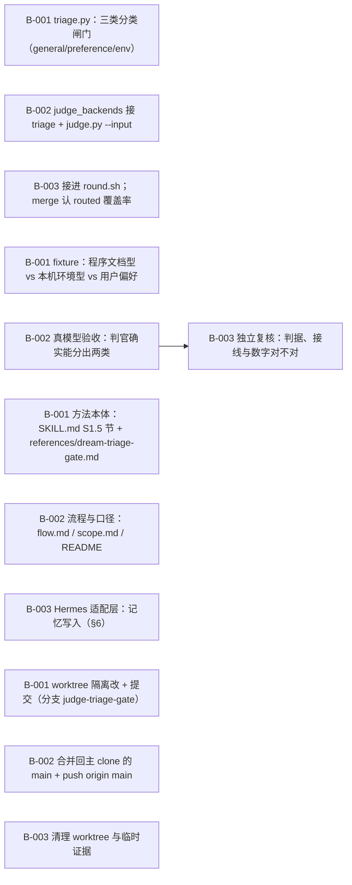

# judge 前置分类闸门（S1.5）：通用方案才进包，偏好/本机环境进记忆

> 给 dream 的判官加一道前置分类闸门（S1.5）：按新技能全文判它属于「general 通用解决方案 / preference 用户个人偏好 / env 本机特定环境」三类，只有 general 才进 S2 判落点、写进包；其余两类压缩成 memory{title,text} 写进记忆（用所处 harness 提供的记忆工具，不绑定记忆基座）、不进包，并按 S8 退役 profile 副本。限制：新开 worktree 做。验收：写一批像程序文档的技能 + 一批像本机环境记录的技能（例如 JEV 不可达），证实判官确实能分出两类；合并回 main 并推送。

**进度** 9/12 块（75%） · 状态 `active` · 更新于 2026-10-13 00:39

**参与方** Hermes(dev-general)(agent) · 本人(human)

## 现在该谁动（NOW / NEXT）

- `T-002#B-003` **独立复核：判据、接线与数字对不对** — 待认领 · @未指派
- `T-004#B-002` **合并回主 clone 的 main + push origin main** — 待认领 · @未指派
- `T-004#B-003` **清理 worktree 与临时证据** — 待认领 · @未指派

## 图

## 任务

### T-001 分类闸门落地 — 已完成
- [x] `T-001#B-001` **triage.py：三类分类闸门（general/preference/env）** _impl_ — 已完成
    - 做什么：新脚本 skills/dream/scripts/triage.py：读 judge-input-bodies.json（scan 冻结的候选），按字节分块、逐块落盘、断点续跑、非流式调后端；产出 triage-<backend>.jsonl（id/kind/reusable/why/evidence/confidence/memory）、triage-summary.json（计数 + memory_queue）、judge-input-bodies.routed.json（只留 general，= S2 的输入）。reusable 由脚本算，空 evidence 的行丢掉。含 --self-test 离线自检；复用 judge.py 的 chunk。
    - 判据：triage.py --self-test 退 0；dry-run 打印分块计划；产出三份文件名与形状如上
    - run 2026-10-13 00:39 hermes pending→done 
- [x] `T-001#B-002` **judge_backends 接 triage + judge.py --input** _impl_ — 已完成
    - 做什么：judge_backends.py 新增 TRIAGE_KINDS / _TRIAGE_RULES / validate_triage_rows / _build_triage_prompt / triage_openai / triage_jev / triage_chunk / triage_chunk_with_fallback，并把校验（三类、非空 evidence、非 general 必须有 memory）放进 --self-test；judge.py 加 --input（默认 judge-input-bodies.json），S2 改指 routed 那份。
    - 判据：judge_backends.py --self-test 退 0（含 triage 校验与分派两组新断言）；judge.py --help 里有 --input
    - run 2026-10-13 00:39 hermes pending→done 
- [x] `T-001#B-003` **接进 round.sh；merge 认 routed 覆盖率** _impl_ — 已完成
    - 做什么：round.sh 在 S1 与 S2 之间加 S1.5（triage.py），S2 改指 judge-input-bodies.routed.json；sweep-plan.py merge 读 judge-input-bodies.routed.json：在则覆盖率只算那几条（被分流的行不算缺判），不在则按全量（向后兼容），并把闸门读数打出来。
    - 判据：sweep-plan.py --self-test 退 0（新增：routed 在 → 覆盖率只算它；范围内没判 → 仍 exit 4；拿掉 routed → 回全量）；round.sh --plan 打印里含 S1.5 且 S2 带 --input
    - run 2026-10-13 00:39 hermes pending→done 

### T-002 验收：两类技能必须分开 — 待认领
- [x] `T-002#B-001` **fixture：程序文档型 vs 本机环境型 vs 用户偏好** _impl_ — 已完成
    - 做什么：tests/triage/fixtures/ 下 5 条真技能（带 frontmatter 与正文）：parse-csv-with-pandas、git-bisect-workflow（程序文档型，期望 general）；jev-unreachable-here（本机 JEV 451 记录）、local-python-interpreters（本机解释器现状，期望 env）；console-language-preference（期望 preference）。expected.json 写死每条的期望。
    - 判据：5 条 fixture 都在；expected.json 的 expect 覆盖全部 5 条；两类（general 与非 general）都有
    - run 2026-10-13 00:39 hermes pending→done 
- [x] `T-002#B-002` **真模型验收：判官确实能分出两类** _impl_ — 已完成
    - 做什么：tests/triage/acceptance.py 按 scan 的形状造 judge-input-bodies.json，跑 triage.py，逐条比 expected.json，并断言 routed 只剩 general、非 general 都带非空 memory 载荷。真调 ~/.hermes/dream-judge.json 的后端（不是桩）。
    - 判据：acceptance.py 退 0 且 5/5 判对、两类分开；JEV 优先与 deepseek-only 两条路径各跑一次都 PASS，逐条结果入证据
    - run 2026-10-13 00:39 hermes pending→done 
- [ ] `T-002#B-003` **独立复核：判据、接线与数字对不对** _review_ — 待认领
    - 做什么：另一个人（子代理，只读、前台、不许起后台进程）独立复核：① triage.py 的形状校验真的丢坏行、reusable 真是脚本算的；② merge 真的按 routed 算覆盖率（不是只看打印）；③ round.sh 的 S1.5/S2 接线对得上；④ 重跑 self-test 与 acceptance 拿到的数字与贴出来的一致；⑤ 文档里的命令能照着跑。
    - 判据：复核给出逐条结论（✓/✗），✗ 的当场整改或写进反馈；重跑的数字与原报告一致
    - 依赖：T-002#B-002（任务级）

### T-003 文档与口径 — 已完成
- [x] `T-003#B-001` **方法本体：SKILL.md S1.5 节 + references/dream-triage-gate.md** _impl_ — 已完成
    - 做什么：skills/dream/SKILL.md：边界加分类闸门一条、分工表加 S1.5 行、新增 S1.5 节、S2 改指 routed、反例加一条、Support files 加两行；新建 references/dream-triage-gate.md（三类判据、命令、三份产出、写记忆的去路、复核口径）；references/dream-method.md 加 s1.5 转指；references/dream-judge-routing.md 开头写明「分类闸门不是这一步」。
    - 判据：SKILL.md 第一层仍只放边界/分工/决议/每步一行转指；dream-triage-gate.md 被 SKILL.md 点名（无孤儿文档）
    - run 2026-10-13 00:39 hermes pending→done 
- [x] `T-003#B-002` **流程与口径：flow.md / scope.md / README** _impl_ — 已完成
    - 做什么：docs/flow.md：§0 加先分类、§3 阶段表加 S1.5 行、§4 模型步加 S1.5、§8 图加一行、§9 锚点加一行、§2 判官输入改 routed；docs/scope.md：四条硬口径改五条 + 口径⑤、§6 的 local·mgr=no·ext=no 行写清先过闸门；README：首段+索引表两行。
    - 判据：grep 到 S1.5 在 flow.md 的阶段表/图/锚点各一处；scope.md 标题是「五条硬口径」且口径⑤在位
    - run 2026-10-13 00:39 hermes pending→done 
- [x] `T-003#B-003` **Hermes 适配层：记忆写入（§6）** _impl_ — 已完成
    - 做什么：skills/dream-hermes-routing/SKILL.md：接口从三处改四处（加「记忆写入」），新增 §6 记忆写入（用 Hermes 的记忆工具写 triage-summary.json 的 memory{title,text}；不绑定记忆基座；写完按 S8 退役），原 §6 扩展点改为 §7。
    - 判据：routing 技能里有 §6 记忆写入；方法本体只写「适配层提供记忆写入口」，没写死任何一家 provider
    - run 2026-10-13 00:39 hermes pending→done 

### T-004 交付：合并回 main 并推送 — 待认领
- [x] `T-004#B-001` **worktree 隔离改 + 提交（分支 judge-triage-gate）** _impl_ — 已完成
    - 做什么：从主 clone 开 worktree ../Dream.wt-triage（分支 judge-triage-gate，基于当时的 main），全部改动与提交都在 worktree 里做，主 clone 不切分支。
    - 判据：git -C <主 clone> worktree list 里有 Dream.wt-triage；提交只在分支 judge-triage-gate 上
    - run 2026-10-13 00:39 hermes pending→done 
- [ ] `T-004#B-002` **合并回主 clone 的 main + push origin main** _impl_ — 待认领
    - 做什么：按包规：不在 worktree 里切 main。回主 clone 执行 git -C <主 clone> merge judge-triage-gate，再 git -C <主 clone> push origin main；推送后核对 origin/main == 本地 main。
    - 判据：git -C <主 clone> status 干净；git ls-remote origin main 的 sha == 本地 main 的 sha
- [ ] `T-004#B-003` **清理 worktree 与临时证据** _impl_ — 待认领
    - 做什么：从主 clone 侧 git worktree remove ../Dream.wt-triage → 删分支 judge-triage-gate → worktree prune；tests/ 的临时产物不留（acceptance.py 默认自删临时目录）。
    - 判据：worktree list 只剩主 clone；分支只剩 main；主 clone git status --porcelain 干净

## 日志（近 20 条）

- `2026-10-13 00:39` **agent** [block] 新增块 T-002#B-001「fixture：程序文档型 vs 本机环境型 vs 用户偏好」
- `2026-10-13 00:39` **agent** [block] 新增块 T-002#B-002「真模型验收：判官确实能分出两类」
- `2026-10-13 00:39` **agent** [block] 新增块 T-002#B-003「独立复核：判据、接线与数字对不对」
- `2026-10-13 00:39` **agent** [block] T-002#B-002 改了 命令
- `2026-10-13 00:39` **agent** [block] T-002#B-003 改了 命令
- `2026-10-13 00:39` **agent** [status] T-002#B-001: pending → done
- `2026-10-13 00:39` **agent** [status] T-002#B-002: pending → done
- `2026-10-13 00:39` **agent** [block] 新增块 T-003#B-001「方法本体：SKILL.md S1.5 节 + references/dream-triage-gate.md」
- `2026-10-13 00:39` **agent** [block] 新增块 T-003#B-002「流程与口径：flow.md / scope.md / README」
- `2026-10-13 00:39` **agent** [block] 新增块 T-003#B-003「Hermes 适配层：记忆写入（§6）」
- `2026-10-13 00:39` **agent** [status] T-003#B-001: pending → done
- `2026-10-13 00:39` **agent** [status] T-003#B-002: pending → done
- `2026-10-13 00:39` **agent** [status] T-003#B-003: pending → done
- `2026-10-13 00:39` **agent** [block] 新增块 T-004#B-001「worktree 隔离改 + 提交（分支 judge-triage-gate）」
- `2026-10-13 00:39` **agent** [block] 新增块 T-004#B-002「合并回主 clone 的 main + push origin main」
- `2026-10-13 00:39` **agent** [block] 新增块 T-004#B-003「清理 worktree 与临时证据」
- `2026-10-13 00:39` **agent** [status] T-004#B-001: pending → done
- `2026-10-13 00:39` **agent** [summary] S1.5 分类闸门落地：triage.py（三类 · 可插拔后端 · 形状校验 · 三份产物）+ judge_backends 的 triage 后端 + judge.py --input + merge 认 routed 覆盖率 + round.sh 接 S1.5。离线自检三件全绿（triage / judge_backends / sweep-plan 各自 --self-test）。真模型验收 tests/triage/acceptance.py：5 条 fixture 全判对（JEV 优先 2.4s；deepseek-only 5.5s），general=2（parse-csv-with-pandas、git-bisect-workflow）· env=2（jev-unreachable-here、local-python-interpreters）· preference=1（console-language-preference），routed 只剩那 2 条 general，非 general 三条都带了非空 memory{title,text} 压缩载荷。
- `2026-10-13 00:39` **agent** [decision] 口径（用户 2026-10-13 拍板）：① 闸门形状＝S1 之后、S2 之前插一道新闸（新脚本 triage.py）——general 才进 S2 判落点；preference/env 出「压缩正文 + 写记忆 + 退役」的行，不进包。② 记忆落点＝让 agent 用**它所在 harness 提供的记忆工具**，不强制某个记忆基座；所以方法本体只写「适配层提供记忆写入口」，Hermes 侧的具体接线在 dream-hermes-routing §6（当前实例是 hindsight）。③ 这次改动同时落一份 loomerto 计划（本 plan，随仓库提交）。
- `2026-10-13 00:39` **agent** [summary] 环境注意：本机 default profile 里没有 load-external-skill-index（skill-index.py 找不到），sweep-plan.py --self-test 需要它才能跑；复跑时把 profile-freeze 快照里的那份临时软链到 skills/ 旁（验完即删，不提交）——已按此跑过并退 0。

---
plan.json 是唯一真相；本文件与 plan.html / plan.canvas 由 `plan.py render judge-triage-gate` 生成。
