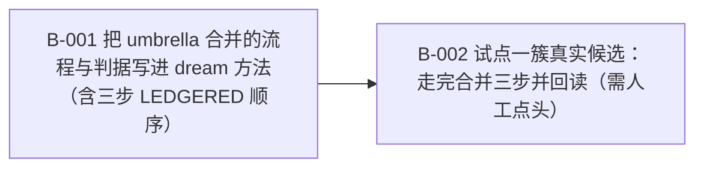

# skill 库结构化整理：由 dream 接管（自治维护已全局关闭）

> 16 个 home 的自治 skill 写入通道已全部关闭（auxiliary.background_review.enabled=false + curator.enabled=false + curator.consolidate=false，YAML 回读 16/16 通过），因此 umbrella-building 没有执行者。把「归类 / 合并 / umbrella」变成 dream 的常规工作线：落点与合并由 dream 的判官 + 交叉审计 + 人工闸判定，而不是靠自治模型顺手改。owner = default profile。

**进度** 0/2 块（0%） · 状态 `active` · 更新于 2026-10-11 11:26

**参与方** Stronghold3369(human) · Default(agent) · 本人(human)

## 现在该谁动（NOW / NEXT）

- `T-001#B-002` **试点一簇真实候选：走完合并三步并回读（需人工点头）** — 待批准 · @default
- `T-001#B-001` **把 umbrella 合并的流程与判据写进 dream 方法（含三步 LEDGERED 顺序）** — 已认领 · @default

## 图

## 任务

### T-001 dream 接管 skill 库的结构化整理（归类 / 合并 / umbrella-building） — 进行中
- [ ] `T-001#B-001` **把 umbrella 合并的流程与判据写进 dream 方法（含三步 LEDGERED 顺序）** _impl_ — 已认领 @default
    - 做什么：背景：自治维护已全局关闭——每轮复盘 fork 与周期 curator pass 都不再对 skill 做任何内容写入，curator 的 LLM 合并 pass（consolidate）也已关闭，所以「把窄 skill 簇合成类级 umbrella」这件事现在没有执行者。框架侧已核事实：合法合并只有三步 LEDGERED 顺序——skill_manage action=write_file 把内容写进 umbrella 的支持目录（references/<topic>.md 按题目命名、templates/、scripts/），再 action=remove_file 删源里的原文，最后 action=delete 源且必须带 absorbed_into=<umbrella>（不带会被守卫 _curator_consolidation_delete_guard 直接拒绝）；shell mv/cp 搬 skill 内容不产生台账记录，明令禁止。判据来源沿用 dream 既有分工：判官定落点、交叉审计核接收侧、人工闸放行。做法：在 skills/dream 的方法里新增「合并 / umbrella」一节（触发判据 = 同一类任务上有 2+ 成员，且维护者会为这一类起一个名字），写清三步顺序、absorbed_into 参数、以及 umbrella 的 description 必须把触发类留在前 57 字符窗口内（否则新钩子静默挤掉旧触发词）；并在 skills/dream-hermes-routing/SKILL.md 里点名转指本节。
    - 判据：① skills/dream 的方法里有「合并 / umbrella」一节，含三步 LEDGERED 顺序与 absorbed_into 参数（贴 grep -n 原文）；② 该节被 skills/dream-hermes-routing/SKILL.md 点名转指（贴 grep -n 原文）；③ 反例段至少两条：不带 absorbed_into 的 delete、用 shell mv/cp 搬内容（原句贴出）；④ 该节写明「umbrella 的 description 必须把触发类留在前 57 字符」（原句贴出）；⑤ python3 -B skills/dream/scripts/check-disclosure.py skills/dream --require-references exit 0（贴输出）。
- [ ] `T-001#B-002` **试点一簇真实候选：走完合并三步并回读（需人工点头）** _impl_ — 待批准 @default
    - 做什么：做法：挑一簇真实的 2+ 成员窄 skill 簇（同一类任务、agent-created / local），按 B-001 的三步走完：write_file 到 umbrella 的支持目录 → remove_file 源 → delete 源并带 absorbed_into=<umbrella>。注意：关掉的是自主写入通道（background_review fork / curator pass）；本人前台发起的 skill_manage 不受影响——合并必须有人在场。本块默认 blocked（待批准），等用户点头才动。
    - 判据：① 贴出候选簇清单原文，指明选了哪一簇、成员是谁；② 三步各贴一条台账记录（.curator_ledger.jsonl 里的 write_file / remove_file / delete 行）；③ 回读 umbrella 的支持目录里确有合并后的文件（ls -la 原文）；④ 被吸收的源 skill 出现在 skills/.archive/ 里（ls 原文），且 hermes skills list 里不再出现（贴输出）；⑤ 合并后 umbrella 的 description 前 57 字符仍是触发类（贴前 57 字符）。
    - 依赖：T-001#B-001

## 日志（近 20 条）

- `2026-10-11 11:26` **agent** [created] 建立 plan：skill 库结构化整理：由 dream 接管（自治维护已全局关闭）
- `2026-10-11 11:26` **本人** [task] 新增任务 T-001「dream 接管 skill 库的结构化整理（归类 / 合并 / umbrella-building）」
- `2026-10-11 11:26` **本人** [block] 新增块 T-001#B-001「把 umbrella 合并的流程与判据写进 dream 方法（含三步 LEDGERED 顺序）」
- `2026-10-11 11:26` **本人** [block] 新增块 T-001#B-002「试点一簇真实候选：走完合并三步并回读（需人工点头）」
- `2026-10-11 11:26` **本人** [assign] T-001#B-001 指派给 default（交接给 default profile：B-001 无需审批，可直接开工）
- `2026-10-11 11:26` **本人** [assign] T-001#B-002 指派给 default（交接给 default profile：保持 blocked，等用户点头）

---
plan.json 是唯一真相；本文件与 plan.html / plan.canvas 由 `plan.py render skill-library-stewardship` 生成。
